# The Definitive Architecture of YC AI Finance & Accounting (2025–2026)
## A Lossless Technical Compendium, Architectural Decomposition, and Strategic Playbook

---

## Table of Contents
1. [Executive Summary & Macro Market Dynamics](#1-executive-summary--macro-market-dynamics)
2. [The Five Architectural Paradigms of Modern AI Finance](#2-the-five-architectural-paradigms-of-modern-ai-finance)
3. [The Zero-Hallucination Engineering Blueprint](#3-the-zero-hallucination-engineering-blueprint)
4. [Pillar I: Autonomous General Ledgers & Full-Stack Firms](#4-pillar-i-autonomous-general-ledgers--full-stack-firms)
   - [4.1 Last Accounting Company (LAC)](#41-last-accounting-company-lac)
   - [4.2 Billow AI Labs](#42-billow-ai-labs)
   - [4.3 Balance (GetBalance)](#43-balance-getbalance)
   - [4.4 Sintropix](#44-sintropix)
   - [4.5 Cranston AI](#45-cranston-ai)
5. [Pillar II: Audit, Assurance & Regulatory Compliance](#5-pillar-ii-audit-assurance--regulatory-compliance)
   - [5.1 Denki](#51-denki)
   - [5.2 Arden](#52-arden)
   - [5.3 Definite](#53-definite)
6. [Pillar III: Order-to-Cash (O2C) & Enterprise AP/AR Portals](#6-pillar-iii-order-to-cash-o2c--enterprise-apar-portals)
   - [6.1 Rex](#61-rex)
   - [6.2 Alder](#62-alder)
   - [6.3 FullSeam](#63-fullseam)
7. [Pillar IV: Continuous Payment Reconciliation](#7-pillar-iv-continuous-payment-reconciliation)
   - [7.1 End Close](#71-end-close)
8. [Pillar V: Capital Markets & Native Canvas Automation](#8-pillar-v-capital-markets--native-canvas-automation)
   - [8.1 Zarna AI](#81-zarna-ai)
   - [8.2 Cohesion](#82-cohesion)
   - [8.3 o11](#83-o11)
9. [Master Cross-Company Architectural Matrix](#9-master-cross-company-architectural-matrix)
10. [Outbounder Strategic Weaponization Playbook](#10-outbounder-strategic-weaponization-playbook)

---

## 1. Executive Summary & Macro Market Dynamics

Between late 2024 and mid-2026, Y Combinator orchestrated a massive capital deployment into enterprise finance, accounting, audit, tax, and capital markets technology. This cohort marks a violent departure from the 2022–2023 "first wave" of Generative AI applications. 

The first wave was characterized by:
* **Shallow Conversational Wrappers:** Webchat interfaces querying vector embeddings of static PDFs.
* **Passive Sidebars:** Floating panels in Google Chrome or Microsoft Office that produced text summaries but could not mutate host state.
* **Tolerant Error Models:** Systems that treated 90% or 95% accuracy as a triumph.

In institutional corporate finance, **a 95% or 99% accuracy rate is an operational failure.** If a mid-market general ledger contains 50,000 journal entries per month, a 1% error rate injects **500 corrupt entries**, invalidating trial balances, breaking debt covenants, and triggering audit failure.

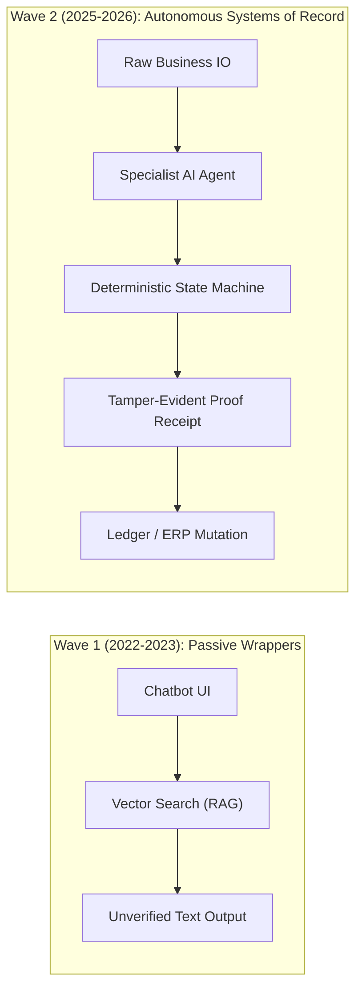

The 2025–2026 YC cohort represents **autonomous systems of execution**. They operate headlessly, bridge legacy software via computer vision, enforce double-entry mathematical invariants, and wrap algorithmic labor in certified human professional liability.

---

## 2. The Five Architectural Paradigms of Modern AI Finance

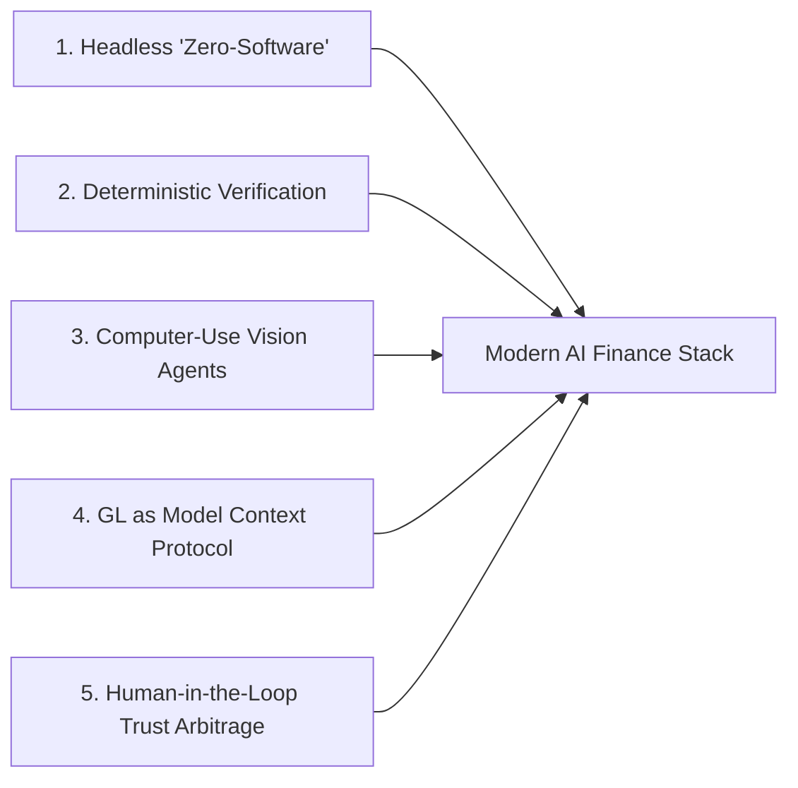

### Paradigm 1: The Death of the Dashboard ("Zero-Software" Architecture)
Enterprise controllers, CFOs, and startup founders suffer from severe SaaS fatigue. Software that requires logging into an independent dashboard faces brutal retention drag. Startups like **Billow AI Labs**, **Rex**, and **Last Accounting Company** operate headlessly:
- They embed directly into existing systems of record (NetSuite, QuickBooks Online, Slack, Coupa, Outlook).
- Work is staged and approved via native Slack interactive blocks or direct ERP draft entries.
- The software feels like an invisible back-office extension rather than a tool requiring human navigation.

### Paradigm 2: Strict Quarantining of Generative LLMs
Generative models (OpenAI GPT-4o, Anthropic Claude 3.5 Sonnet, DeepSeek-V3) are fundamentally probabilistic text prediction engines. In accounting, they are **strictly quarantined**:
- **Permitted LLM Scope:** Unstructured text parsing, OCR semantic alignment, receipt entity extraction, break explanations, and draft email synthesis.
- **Prohibited LLM Scope:** Arithmetic, running balance calculations, reconciliation matching, tax schedule computation, and general ledger journal postings.
- **The Execution Layer:** All ledger computations are governed by deterministic relational state machines, double-entry verification checks, and symbolic logic.

### Paradigm 3: Computer-Use Vision Agents over Non-Existent APIs
In enterprise auditing (SOX 404, PCAOB) and B2B vendor management, APIs do not exist.
- Internal corporate systems (Active Directory, AS400, on-prem SAP instances) lack public REST endpoints.
- Customer AP procurement portals (Coupa CSP, SAP Ariba, Tungsten, Taulia) deliberately disallow programmatic API access for suppliers to enforce manual vendor lock-in.
- Startups like **Arden**, **Rex**, and **Alder** deploy containerized headless browser agents with vision models. These agents log into portals, navigate nested menus, solve multi-factor authentication (MFA) via automated OTP interception, and capture pixel-perfect timestamped screenshots to satisfy PCAOB AS 1105 / AS 2201 Information Produced by the Entity (IPE) audit standards.

### Paradigm 4: General Ledger as a Model Context Protocol (MCP) Server
Legacy general ledgers (QuickBooks, Xero, NetSuite) operate as siloed, proprietary SQL databases behind restrictive rate limits. **Last Accounting Company (LAC)** architected an event-sourced general ledger natively exposed as an **MCP Server**.
- Enterprise AI agents residing in IDEs (Cursor), chat clients (Claude Desktop, Slack), or autonomous pipelines can directly query financial truth via standardized tool contracts (`get_burn_rate`, `simulate_cash_runway`, `get_unmatched_transactions`) without intermediary ETL data warehousing.

### Paradigm 5: Human-in-the-Loop (HITL) as Trust Arbitrage
None of the high-growth YC finance companies sell 100% autonomous unattended software.
- Pure software in finance carries zero professional liability; if an algorithm miscalculates corporate tax or misses a material internal control weakness, the CFO is fired.
- Winning companies operate as **AI-powered firms** or **hybrid platforms**. AI automates 90%–95% of routine data entry, reconciliation, and report drafting; licensed CPAs, ACA accountants, or former Big 4 audit managers audit exceptions and legally sign off on deliverables.

---

## 3. The Zero-Hallucination Engineering Blueprint

To achieve institutional-grade reliability, YC finance architectures decouple execution into three distinct layers:

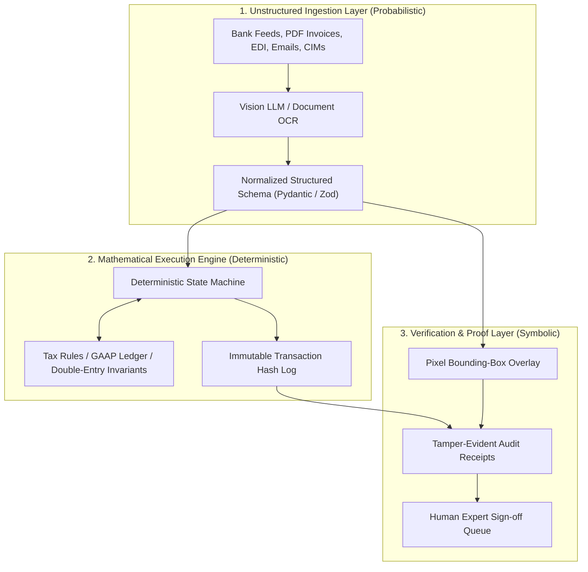

### Mathematical Invariants
Every financial transaction processed must satisfy the double-entry accounting identity at compile time:
$$\sum \text{Debits} \equiv \sum \text{Credits}$$
$$\Delta \text{Cash}_{\text{GL}} \equiv \text{Bank Inflows} - \text{Bank Outflows} - \text{Float Adjustments}$$

If an LLM proposes an unbalanced journal entry, the deterministic ingestion gateway rejects the payload with a schema validation exception before it reaches the ledger.

---

## 4. Pillar I: Autonomous General Ledgers & Full-Stack Firms

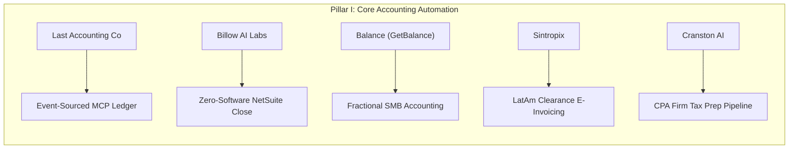

---

### 4.1 Last Accounting Company (LAC)
* **Website:** [lastaccountingcompany.com](https://lastaccountingcompany.com)
* **YC Batch:** Summer 2026 (S26) | **HQ:** Helsinki, Finland & San Francisco, CA
* **Founders:**
  * **Riki Karjalainen & Sami Laakkonen:** Former financial data infrastructure engineers at Token Terminal; built high-throughput pipelines handling petabytes of on-chain and corporate financial records.
  * **Veikko Pere:** Background in BCG strategy consulting, private equity, European corporate law, and corporate finance.
  * **Pietari Virkkunen:** Enterprise software sales and engineering across European tech and private equity.

#### Detailed Product Architecture
LAC replaces both traditional accounting software (QuickBooks, Xero) and the outsourced bookkeeping firm.
- **The Interface:** No standalone web dashboard. Founders interact with an agent named **"Björn"** embedded inside **Slack** or via a **Model Context Protocol (MCP)** interface.
- **Real-Time Queries:** Founders query corporate runway, burn rate, departmental spend anomalies, and cash forecasting in natural language. The agent translates prompts into programmatic SQL/GraphQL queries against the underlying ledger.
- **Continuous Bookkeeping:** Transaction metadata is captured at the moment of spend. Bank feeds (via PSD2 Open Banking in Europe and Plaid in the US) stream raw transactions. The agent categorizes transactions based on vendor history, tax regulations, and team Slack context.
- **Statutory Sign-Off:** Human accountants validate all staged journal entries, prepare monthly local VAT and corporate income tax filings, and provide legal audit signatures.

#### Technical Implementation
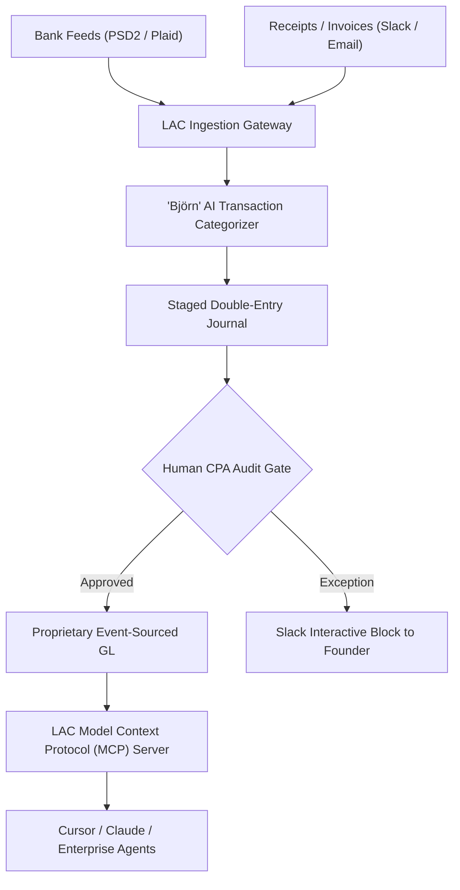

- **Proprietary Ledger:** Instead of writing to legacy rate-limited QuickBooks APIs, LAC engineered an event-sourced ledger on top of transactional PostgreSQL. Every state change is stored as an immutable debit/credit event.
- **MCP Integration:** Exposes read/write primitives via MCP, allowing external coding and operations agents to verify budget availability before executing purchases.

#### Defensibility & Market Differentiation
- **vs. Pilot / Kruze:** Pilot and Kruze rely on QBO as the backend database, requiring large offshore operations teams in South America and India to manually fix broken data syncs. LAC owns the core ledger, eliminating API sync errors.
- **Target Customer:** Venture-backed technology startups, digital agencies, and cross-border companies (1–50 employees) across Europe and the United States.

---

### 4.2 Billow AI Labs
* **Website:** [thebillow.ai](https://thebillow.ai)
* **YC Batch:** Summer 2026 (S26) | **HQ:** San Francisco, CA
* **Founders:**
  * **Joanathan McIntosh (CEO):** Enterprise software engineer; built automated financial systems.
  * **Philip Moniaga (CTO):** Ex-Stripe infrastructure engineer; deep expertise in ledger consistency and distributed systems.

#### Detailed Product Architecture
Billow positions itself as **"Killing Deloitte with AI"** for mid-market and pre-IPO technology companies.
- **The Problem:** Companies with $15M to $100M ARR outgrow QuickBooks and migrate to NetSuite or SAP. At this scale, the month-end close becomes an operational nightmare requiring 15–25 days of manual labor: accruals, prepaid expense amortizations, deferred revenue schedules, and intercompany reconciliations.
- **Zero-Software Execution:** Billow does not require the customer to migrate away from NetSuite. It establishes a two-way synchronization pipeline with NetSuite’s SuiteTalk REST/SOAP APIs.
- **Automated Workpapers:** The engine pulls trial balances, general ledger transactions, and subledger data, auto-populates closing workpapers in Excel, calculates exact accruals, and stages balancing journal entries directly inside NetSuite as pending review.

#### Technical Architecture
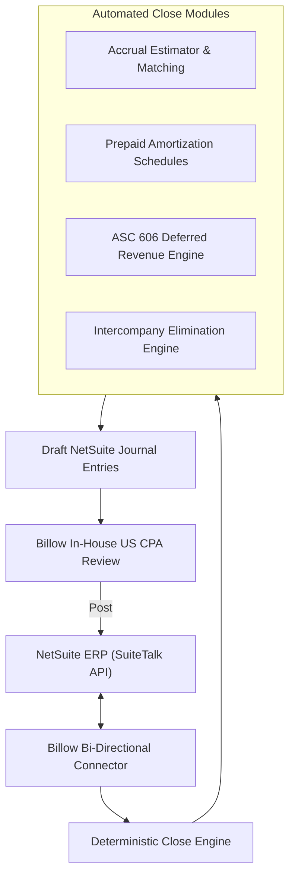

- **Deterministic Accrual Modeling:** Matches open purchase orders (POs) against vendor invoices and receiving receipts. Calculates unbilled liabilities and posts exact month-end accrual entries with automatic reversing dates.
- **Human Oversight:** In-house US-based CPAs review every workpaper and staged journal entry before posting to NetSuite, providing enterprise controllers with complete confidence.

#### Pricing & Economics
- **Pricing:** Tiered annual contracts from **$1,000/month** (early NetSuite adopters) to **$7,500/month** (complex multi-subsidiary global enterprises).
- **ROI:** Replaces $150,000/year senior accounting hires or $200,000+ outsourced Big 4 advisory fees, compressing the close cycle from 20 days to 2 days.

---

### 4.3 Balance (GetBalance)
* **Website:** [getbalance.ai](https://getbalance.ai)
* **YC Batch:** Winter 2026 (W26) | **HQ:** Copenhagen, Denmark & London, UK
* **Founders:**
  * **Emil Munk (CEO):** Fintech founder with deep background in European payments and corporate banking.
  * **Mathias Lovring & Gus Levinson:** Technical leads in distributed backend systems and workflow automation.

#### Detailed Product Architecture
Balance provides an **outsourced AI finance department for SMBs and direct-to-consumer (D2C) brands**.
- **The Core Persona:** Operates through an AI agent named **"Bea"**.
- **Supported Systems:** Integrates with local European and UK accounting packages: **Xero, QuickBooks Online, e-conomic (Visma), and Microsoft Dynamics 365 Business Central**.
- **Workflows Handled:**
  - Automated bookkeeping and receipt capture via email forwarding and WhatsApp.
  - VAT returns and statutory filings compliant with HMRC (UK Making Tax Digital) and Danish Skat.
  - Real-time debtor tracking and automated invoice dunning.
  - Accounts payable approval workflows.

#### Human-in-the-Loop Safeguards
Balance pairs the autonomous engine with **ACA-qualified (UK) and state-authorized (Nordic) public accountants**.
- The AI handles 95% of routine categorization and bank reconciliation.
- Human accountants audit ledger balances at month-end, perform statutory year-end closing, and file certified financial statements.

#### Pricing & Unit Economics
- **Pricing:** Flat subscription of **£350/month (UK)** or **4,000 DKK/month (Denmark)**.
- **Value Equation:** Traditional UK bookkeeping services charge £1,500–£3,000/month for equivalent coverage. Balance achieves >80% gross margins by automating ingestion and draft journal creation.

---

### 4.4 Sintropix
* **Website:** [sintropix.com](https://sintropix.com)
* **YC Batch:** Fall 2026 (F26) | **HQ:** Mexico City, Mexico & Santiago, Chile
* **Founders:**
  * **Alfonso Márquez de la Plata (CEO) & Borja Marquez de la Plata (COO):** LatAm enterprise operators with deep domain experience in regional tax compliance, clearance e-invoicing, and enterprise ERP systems.

#### Detailed Product Architecture
Sintropix is the **autonomous accounting and ERP platform for global and multi-entity companies operating in Latin America**.
- **The LatAm Structural Moat:** Unlike the US, where tax compliance is largely self-reported post-facto, Latin America operates under strict **clearance-based electronic invoicing mandates**:
  - Mexico: **SAT (Servicio de Administración Tributaria)** requiring signed XML **CFDI** (Comprobante Fiscal Digital por Internet) for every transaction.
  - Chile: **SII (Servicio de Impuestos Internos)** requiring validated **DTE** (Documento Tributario Electrónico).
  - Colombia: **DIAN** clearance protocols.
- **Multi-Entity General Ledger:** Integrates directly with government tax portals to ingest validated XMLs in real time, bypassing manual invoice scanning.
- **Automated Bookkeeping & FX Revaluation:** Maps multi-currency operations across USD, MXN, CLP, and COP, automatically calculating localized tax withholdings (IVA, ISR, Retenciones) and posting foreign exchange gains/losses according to local statutory GAAP.

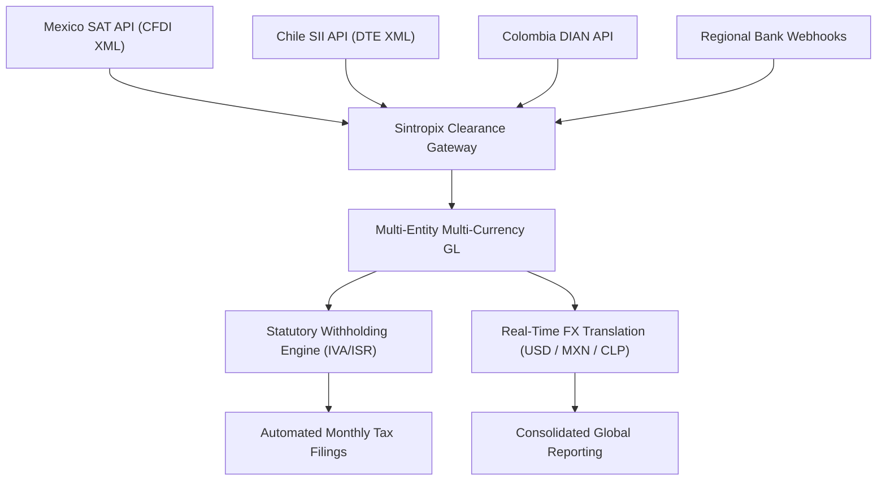

#### Defensibility
Global enterprise ERPs (NetSuite, SAP) require costly third-party localization packages (costing $50,000–$150,000 per country) that break frequently. Sintropix provides native, automated compliance out of the box.

---

### 4.5 Cranston AI
* **Website:** [cranston.ai](https://cranston.ai)
* **YC Batch:** 2025/2026 Cohort | **HQ:** United States
* **Founders:** Team of enterprise AI researchers and veteran CPAs.

#### Detailed Product Architecture
Cranston AI builds **AI tax preparation and continuous bookkeeping software engineered specifically for CPA firms**.
- **The Industry Bottleneck:** Over 75% of US CPAs are at or near retirement age, creating a catastrophic labor shortage in public accounting. Small-to-midsize accounting firms turn away high-margin clients because they lack junior staff to key tax forms into legacy software.
- **Software Integration:** Cranston does not seek to displace dominant professional tax preparation platforms: **Drake Software, CCH Axcess, Intuit Lacerte, and Thomson Reuters UltraTax**.
- **Automated Ingestion Pipeline:**
  - Ingests scanned client source documents: W-2s, 1099-INT/DIV/NEC/MISC, K-1s, brokerage statements, mortgage interest forms (1098), and P&L trial balances.
  - Employs computer vision and OCR to extract line-level tax data.
  - Maps extracted figures directly into the data schemas of Drake, Lacerte, or CCH Axcess, populating draft federal (Form 1040, 1120, 1120-S, 1065) and state returns.

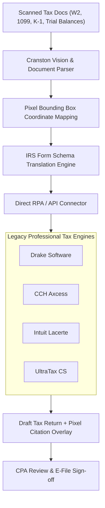

#### The Pixel-Bounding-Box Verification Moat
Every calculated field inside the draft tax return contains an interactive hyperlink. When the CPA clicks a number, Cranston displays the original source PDF with a **highlighted pixel bounding box**, allowing instantaneous visual verification and eliminating transcription errors.

#### Unit Economics
- Billed directly to CPA firms on a usage basis: **$30/client book/month** for automated continuous bookkeeping; **$40/tax return prepared**.
- Enables a single CPA to increase their active return capacity from 200 returns/season to over 1,000 returns/season.

---

## 5. Pillar II: Audit, Assurance & Regulatory Compliance

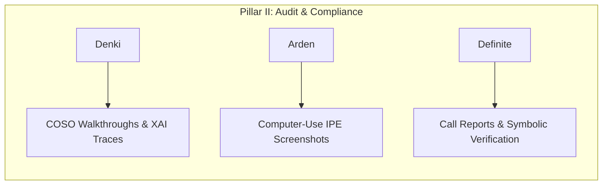

---

### 5.1 Denki
* **Website:** [denki.ai](https://denki.ai)
* **YC Batch:** Fall 2025 (F25) | **HQ:** London, UK & San Francisco, CA
* **Founders:**
  * **Felipe (CEO):** Ex-McKinsey consultant; PhD research in Explainable AI (XAI) at University College London (UCL); former Head of Product/Engineering at a GE-backed enterprise startup.
  * **David (CTO):** Built high-throughput unstructured financial data pipelines at MacroHive (trusted by the top 5 global hedge funds); top-13 UK Informatics Olympiad competitor; Imperial College London Computing graduate.

#### Detailed Product Architecture
Denki is the **full-stack AI internal audit and assurance firm**, targeting the $290B+ global spend on statutory compliance (SOX 404, BSA/AML, ISO 27001).
- **The Core Problem:** Corporate audit remains dependent on manual, point-in-time sampling (e.g., testing 25 out of 10,000 journal entries) due to human time constraints. This fails to detect systemic fraud and creates massive frictional cost during external Big 4 audits.
- **Workflow Automation:**
  - Plugs into existing GRC software (**AuditBoard, Workiva**) and enterprise ERPs (**SAP, NetSuite, Oracle**).
  - Automatically maps financial workflows to the **COSO (Committee of Sponsoring Organizations)** Internal Control Framework.
  - Autonomous Interview Agent: Conducts control walkthrough interviews with process owners, recording, transcribing, and extracting control evidence.
  - Full-Population Testing: Evaluates 100% of transactions against control assertions rather than statistical samples.
  - Automated Working Papers: Generates standardized audit working papers complete with full lineage, mathematical verification, and cross-referenced evidence files.

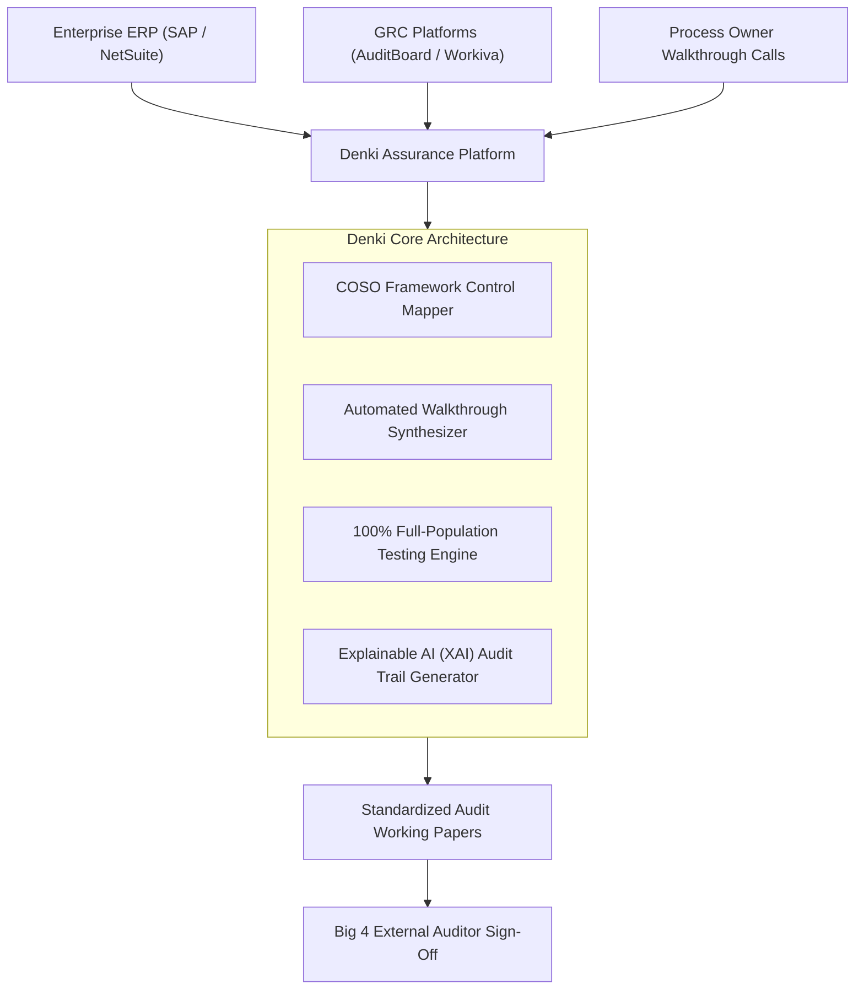

#### Defensibility & Explainable AI
External auditors reject black-box models. Denki’s XAI engine generates explicit deterministic proof trees for every control conclusion, showing the exact regulatory clause, control requirement, underlying system log, and mathematical verification.

---

### 5.2 Arden
* **Website:** [arden.ai](https://arden.ai) / [ardentech.ai](https://ardentech.ai)
* **YC Batch:** Summer 2026 (S26) | **HQ:** San Francisco, CA
* **Founders:**
  * **Aryaman Khanna (CEO):** AI systems researcher and enterprise software builder.
  * **David (CTO):** Systems architect specializing in browser automation and secure runtime sandboxes.

#### Detailed Product Architecture
Arden is an **AI-native internal audit platform automating evidence collection and testing for Sarbanes-Oxley (SOX) compliance**.
- **The Problem:** Internal audit teams spend thousands of hours each quarter manually logging into enterprise applications, navigating to user administration screens, and taking screenshots of user access lists, configuration settings, and approval hierarchies to prove controls were operating effectively.
- **Computer-Use Vision Agents:** Arden deploys autonomous vision-based agents that execute tasks inside the target applications.
  - The agent logs into Okta, Salesforce, AWS IAM, SAP, or NetSuite.
  - Navigates to the relevant control view (e.g., verifying that multi-factor authentication is enforced across all privileged administrators).
  - Captures timestamped, cryptographically hashed screenshots.
  - Compiles the screenshots and associated metadata into completed testing workpapers.

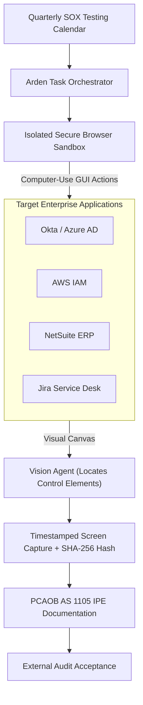

#### PCAOB IPE Compliance Moat
External Big 4 auditors operate under PCAOB Auditing Standard **AS 1105 (Audit Evidence)** and **AS 2201**, which impose strict guidelines regarding the reliability of **Information Produced by the Entity (IPE)**. Auditors routinely reject raw API dumps or JSON payloads because they can be altered in transit. Arden’s computer-use screenshots preserve visual fidelity, system clocks, and full URL provenance, satisfying external auditor scrutiny without friction.

---

### 5.3 Definite
* **Website:** [usedefinite.com](https://usedefinite.com)
* **YC Batch:** Summer 2026 (S26) | **HQ:** San Francisco, CA
* **Founders:**
  * **Gurshabd, Mazin, Farhan:** Deep engineering background in foundational language models, symbolic AI systems, and financial regulatory ontologies.

#### Detailed Product Architecture
Definite automates **regulatory reporting and compliance for financial institutions**, focusing primarily on bank **Call Reports (FFIEC 031 / 041 / 051)** filed quarterly with the FDIC, Federal Reserve, and OCC.
- **The Regulatory Stakes:** Call Reports consist of dozens of intricate financial schedules (Schedule RC, RC-R regulatory capital, RC-C loans, RC-E deposits) governed by thousands of interconnected statutory validation rules. Inaccurate filings trigger severe regulatory fines, consent decrees, and mandatory restatements.
- **The Engine:** Combines **DeepSeek-V3** for semantic interpretation of unstructured banking documentation with a **deterministic symbolic verification engine**.
- **Academic Benchmarks:** Evaluated on **FinBalance** (multi-document institutional reconciliation benchmark) and **FinAuditing** (XBRL structural and semantic validation benchmark). Outperforms state-of-the-art generalist models (including GPT-4o and Claude 3.5 Sonnet) while running at **50× lower inference cost**.

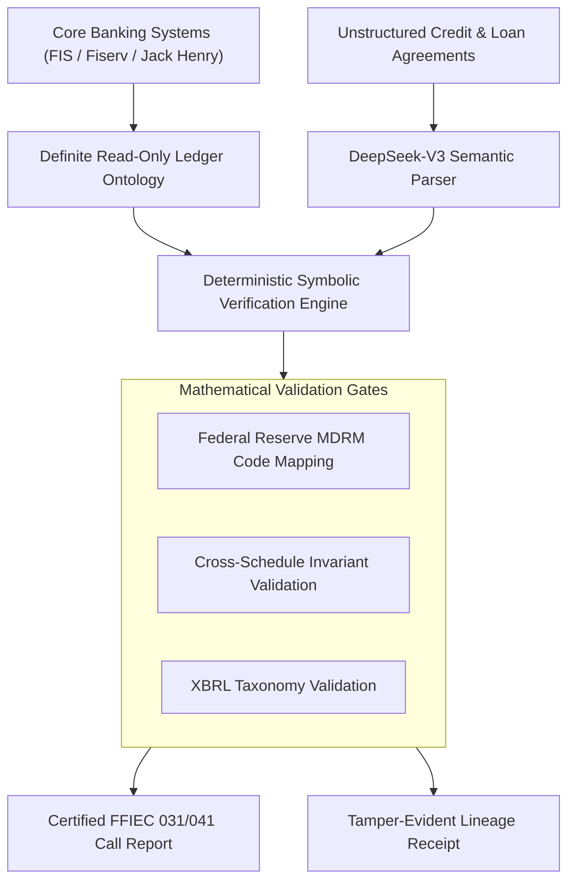

#### The Audit Receipt Guarantee
Definite produces a **mathematical lineage receipt** for every cell on every schedule. A bank compliance officer or FDIC bank examiner can inspect any line (e.g., Tier 1 Risk-Based Capital) and immediately trace the figure back through the exact deterministic formulas to the underlying general ledger account IDs and loan portfolio balances.

---

## 6. Pillar III: Order-to-Cash (O2C) & Enterprise AP/AR Portals

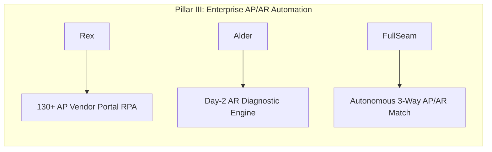

---

### 6.1 Rex
* **Website:** [rex.inc](https://www.rex.inc)
* **YC Batch:** Summer 2026 (S26) | **HQ:** San Francisco, CA
* **Founders:**
  * **Merlin Kafka (CEO) & Lewis Blackwood (CTO):** Repeat fintech and workflow automation operators.

#### Detailed Product Architecture
Rex is an **AI-native BPO (Business Process Outsourcer) managing Order-to-Cash and AP vendor portal automation for high-growth enterprise suppliers**.
- **The Enterprise Vendor Trap:** When a venture-backed tech company sells software or services to Fortune 500 enterprises (e.g., Walmart, General Electric, Google), the enterprise buyer refuses to receive PDF invoices via email. The buyer mandates that the supplier manually log into their internal procurement portal (**Coupa CSP, SAP Ariba, Tungsten Network, Taulia, Jaggaer**) to:
  1. Locate the specific approved Purchase Order (PO).
  2. Transcribe line items, unit quantities, and tax breakdowns.
  3. Upload matching PDF invoices and shipping receipts.
  4. Track payment approvals and resolve portal rejections.
- **The Execution Engine:** Rex built automated connectors for **over 130 procurement portals**.
  - Operates a headless browser cluster capable of navigating unique buyer configurations.
  - Solves MFA automatically using dynamic email subaddressing and Twilio-backed virtual phone numbers to intercept SMS OTPs.
  - Continuously monitors payment statuses, invoice rejections, and approved remit dates.

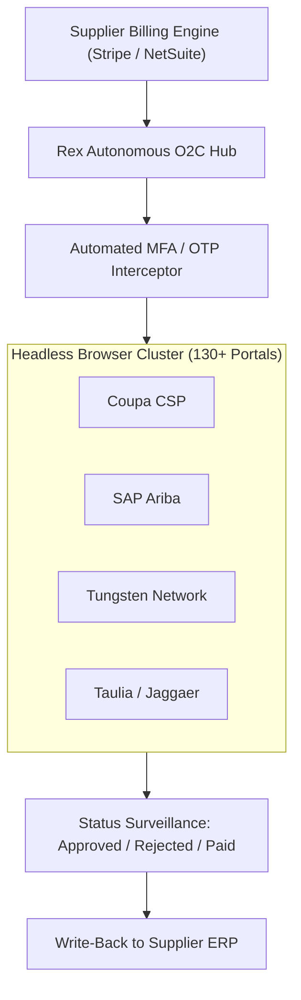

#### Customer Proof & Business Model
Live in production managing multi-million-dollar billing operations for enterprise tech unicorns such as **Synthesia**. Billed as an outcome-based managed service combining automated infrastructure with human operational guarantees.

---

### 6.2 Alder
* **Website:** [meetalder.com](https://meetalder.com)
* **YC Batch:** Fall 2025 (F25) | **HQ:** San Francisco, CA
* **Founders:**
  * **Tejas (CEO):** Veteran enterprise workflow engineer; built large-scale payment collection infrastructure.

#### Detailed Product Architecture
Alder is an **AI employee for Accounts Receivable (AR)** that focuses on reducing Days Sales Outstanding (DSO) and eliminating invoice dispute friction.
- **The Flaw of Legacy AR Software:** Existing AR tools (HighRadius, Chaser, Gaviti) are glorified automated email spammers. When an enterprise invoice becomes 30 days overdue, they blast templated emails to the buyer's accounts payable address. The buyer ignores them because the invoice is trapped in an internal workflow failure.
- **Root-Cause Diagnostics:** Alder syncs with the supplier’s ERP and actively queries the buyer’s AP portal on **Day 2 after invoice generation**, diagnosing:
  - Did the buyer’s PO run out of funds?
  - Did the business unit owner fail to submit an electronic Goods Receipt (GR)?
  - Is there a $0.05 tax calculation mismatch between the supplier's billing engine and the buyer's SAP Ariba configuration?
- **Targeted Resolution:** Alder drafts precise, context-rich emails to the specific internal stakeholder (e.g., emailing the enterprise engineering VP to approve the Goods Receipt) rather than spamming a generic `ap@company.com` inbox.

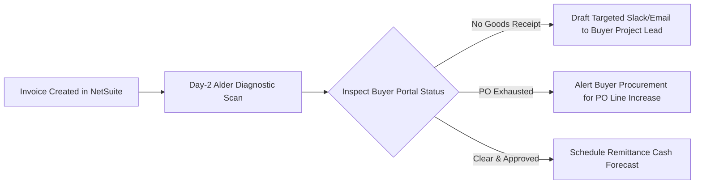

---

### 6.3 FullSeam
* **Website:** [fullseam.com](https://fullseam.com)
* **YC Batch:** 2025/2026 Cohort | **HQ:** San Francisco, CA
* **Founders:**
  * **Tom Dowling, Geoff Segal, Aaron Coppa:** Enterprise software engineers and finance operations specialists.

#### Detailed Product Architecture
FullSeam is an **autonomous finance teammate handling Accounts Payable (AP) 3-way matching and Accounts Receivable (AR) portal workflows**.
- **Automated 3-Way Matching:** Ingests vendor invoices, purchase orders (POs), and receiving documentation. Employs computer vision and layout analysis to match item quantities, unit prices, and payment terms down to the line item.
- **Exception Triage:** Invoices matching within strict mathematical tolerance thresholds are automatically scheduled for payment in NetSuite or QuickBooks. Discrepancies (price variances, missing receiving slips) are flagged with automated inquiries sent to vendors.
- **Portal Invoicing:** Like Rex, FullSeam closes the loop on AR by automatically uploading billed invoices into buyer procurement portals.

---

## 7. Pillar IV: Continuous Payment Reconciliation

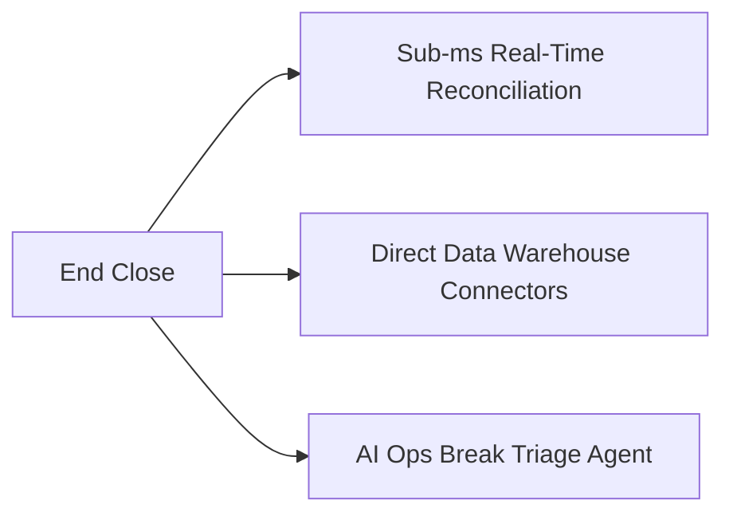

---

### 7.1 End Close
* **Website:** [endclose.com](https://endclose.com)
* **YC Batch:** Winter 2026 (W26) | **HQ:** San Francisco, CA
* **Investors:** Backed by Foundation Capital, Liquid 2 Ventures, and Sunflower Capital.
* **Founders:**
  * **Sean Bolton (CEO):** 3rd employee at **Modern Treasury** (YC S18); spent 6 years leading payments engineering and architecting `LedgerSync`, which reconciled **over $1 Trillion annually** in enterprise payment volume.
  * **David Newell (CTO):** Repeat YC founder (Unflow, YC S19); led error-tracking product engineering at **PostHog** (YC W20).

#### Detailed Product Architecture
End Close is an **autonomous continuous reconciliation engine engineered specifically for high-volume fintechs, marketplaces, neobanks, and payment processors**.
- **The Month-End Batch Crisis:** Legacy reconciliation tools (BlackLine, Trintech) were built in the 1990s. They rely on batch ETL jobs run at the end of each calendar month. For a neobank or marketplace processing millions of transactions daily across ACH, Fedwire, RTP, Card Networks, and internal ledgers, month-end batch processing creates catastrophic operational lag. Cash breaks remain undetected for 30 days, creating severe regulatory exposure and fraud vulnerability.
- **Continuous Multi-Way Matching:** Ingests records in real time from:
  - Enterprise Data Warehouses: **Snowflake, Google BigQuery, AWS Redshift, Databricks**.
  - Banking Settlement Formats: **CAMT.053 (XML), BAI2, MT940, Fedwire, NACHA ACH files**.
  - Gateway Settlement Feeds: Stripe, Adyen, Checkout.com, Modern Treasury.
- **Sub-Millisecond Hash Matching:** Normal-course transactions (over 99% of total volume) are matched instantly using deterministic multi-key hash indices.

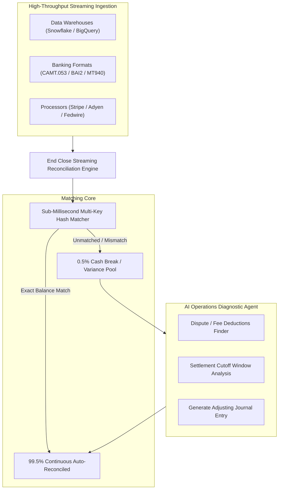

#### The AI Ops Diagnostic Agent
When a transaction breaks (e.g., bank settlement is $954.80 but internal ledger indicates $1,000.00), End Close’s agent inspects processor metadata, identifies that Stripe withheld a $45.20 dispute reserve, writes an explanatory reconciliation note, and stages the balancing entry automatically.

---

## 8. Pillar V: Capital Markets & Native Canvas Automation

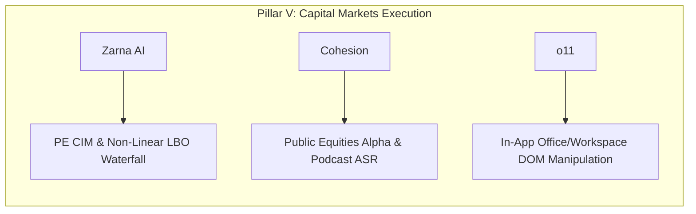

---

### 8.1 Zarna AI
* **Website:** [zarnaai.com](https://www.zarnaai.com)
* **YC Batch:** Fall 2025 (F25) | **HQ:** San Francisco, CA
* **Founders:**
  * **Rishabh Dhariwal (CEO):** Ex-AEA Investors ($20B+ middle-market PE firm) leading enterprise AI enablement; ex-Deutsche Bank Investment Banking; UC Berkeley Economics.
  * **Hrishi Joshi, Vivan Agrawal, Rakesh Mehta:** UC Berkeley CS/EECS alumni; ex-forward deployed engineers embedded directly in private equity deal teams.

#### Detailed Product Architecture
Zarna provides **autonomous "AI Associates" that automate the entire front-of-deal lifecycle for Private Equity, Growth Equity, and Private Credit funds**.
- **1-Hour CIM Screening:** Ingests 80–150 page Confidential Information Memorandums (CIMs) and teasers directly from Outlook inboxes. Automatically extracts company fundamentals, margins, customer concentration, and CapEx, scoring the target against the fund’s specific investment thesis within 60 minutes.
- **Deterministic Non-Linear Debt Modeling:** Generic LLMs fail completely at LBO modeling because debt schedules require circular, non-linear logic. Zarna couples language understanding with deterministic financial calculation engines to model:
  - Multi-tier capital structures: Revolver, Term Loan A, Term Loan B with floating interest (SOFR + spread) and mandatory amortization.
  - Cash flow sweep mechanics: Programmatically sweeps excess free cash flow to accelerate debt paydown.
  - Mezzanine & PIK Interest: Toggles Payment-in-Kind (PIK) compounding against cash pay interest.
  - Covenant checks: Real-time calculation of Total Leverage, Senior Leverage, and Fixed Charge Coverage Ratios (FCCR).
- **Deliverable Generation:** Automatically drafts investment committee (IC) memos, tear sheets, and IOIs in the firm’s exact corporate style, while synchronizing deal terms into **DealCloud or Salesforce**.

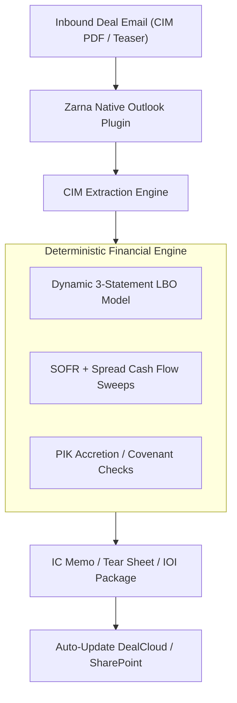

---

### 8.2 Cohesion
* **Website:** [cohesionplatform.com](https://cohesionplatform.com)
* **YC Batch:** Spring 2026 (P26) | **HQ:** New York City, NY
* **Traction:** Live in production with **10+ fundamental equity hedge funds managing over $10 Billion in combined AUM**.
* **Founders:**
  * **Devon Krapcho (CEO):** Ex-Hedge Fund Analyst for 5+ years at **Long Path Partners**, covering public software and technology equities.
  * **Matthew McBrien:** Ex-Security and Cloud Infrastructure Engineer at **Amazon / AWS**.
  * **Matt Munns:** Ex-AI Investment Systems Engineer at **T. Rowe Price**.

#### Detailed Product Architecture
Cohesion is an **agentic research teammate for public equities hedge fund analysts**.
- **Continuous Corporate Surveillance:** Ingests 10-Ks, 10-Qs, 8-Ks, press releases, and earnings call audio in real time. Highlights segment-level revenue variance and detects subtle tone and guidance shifts between quarters.
- **Audio-to-Alpha Multi-Modal Ingestion:** Unstructured alpha is increasingly concentrated outside traditional text filings. Cohesion continuously monitors, transcribes, and indexes:
  - Technical executive podcasts and YouTube industry interviews.
  - Specialized industry conferences and fireside chats.
  - Real-time financial debates on X/Twitter.
- **Second-by-Second Grounding:** Every insight extracted from an audio file contains a direct, clickable playback link to the exact second in the recording, allowing an analyst to verify executive vocal inflection and nuance.
- **Price-Driver Attribution:** Answers the core buy-side question: *"Why is this stock up 6% or down 8% right now?"* by mapping price action to discrete alternative data events.
- **Compliance Core:** Engineered with strict Zero Data Retention (ZDR) agreements and Material Non-Public Information (MNPI) firewalls required by multi-billion-dollar asset managers.

---

### 8.3 o11
* **Website:** [o11.ai](https://o11.ai)
* **YC Batch:** Winter 2026 (W26) | **HQ:** San Francisco & New York City
* **Founders:**
  * **Aryah Oztanir (CEO) & Ajay Misra (CTO):** Former enterprise AI systems engineers; University of North Carolina (UNC) Chapel Hill dropouts.

#### Detailed Product Architecture
o11 is built on the thesis that **"AI inside legacy tools doesn't actually do the work. o11 does."** It provides native in-app workflow execution inside **Microsoft 365 (PowerPoint, Excel, Word)** and **Google Workspace (Docs, Sheets, Slides)** for capital markets teams.

#### Overcoming the "Sidebar Copilot" Fallacy
Microsoft Copilot and Google Gemini operate primarily as chat sidebars. When a banker asks Copilot to *"build a 20-slide pitchbook from this financial model"*, it generates a generic bulleted summary. o11 replaces conversational text with **native canvas and spreadsheet manipulation**:
- **Host DOM Manipulation:** Interfaces directly with host application runtimes via **Office.js** and COM APIs.
- **Abstract Action Graph:** Compiles natural language prompts into deterministic action graphs:
  - In Excel: Manipulates cell ranges, injects dynamic three-statement formulas, formats numbers (`$#,##0;($#,##0);"-"`), and resolves circular dependency trees.
  - In PowerPoint: Directly computes spatial coordinates (`top`, `left`, `width`, `height`), shapes, vector lines, Harvey balls, and z-index layers to generate institutional pitch decks that strictly adhere to corporate typography and color palettes.
- **Valyu.ai Integration:** Rather than building proprietary scrapers, o11 integrates **Valyu.ai** as its real-time financial data layer. Ingests structured SEC filings and corporate fundamentals with strict source citations linking every number back to the original filing.

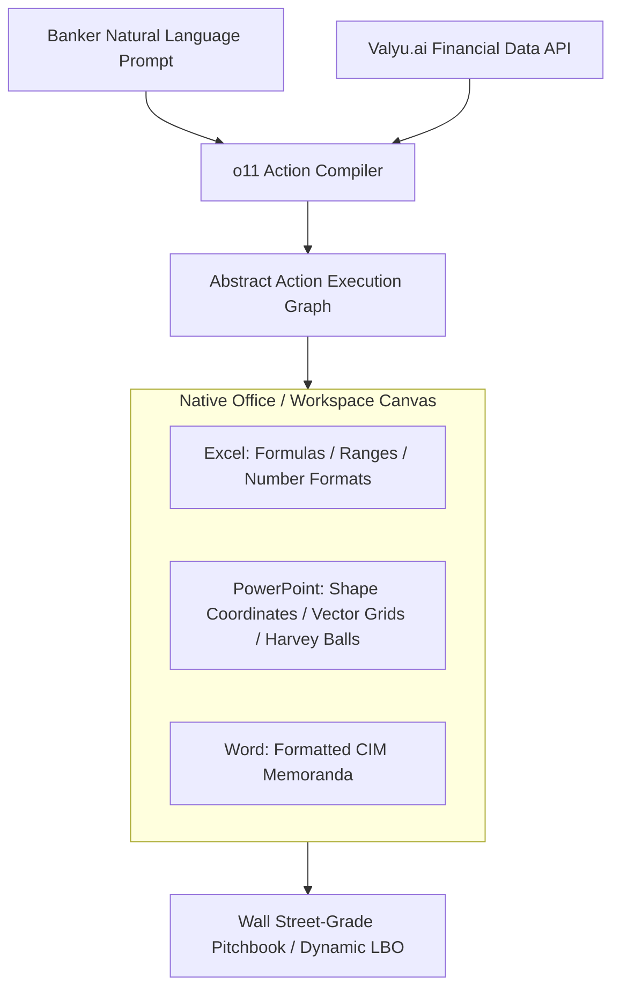

---

## 9. Master Cross-Company Architectural Matrix

| Company | Cohort | Core Problem Solved | Core Architectural Mechanic | Defensibility & Moat | Target ICP | Pricing Model |
| :--- | :--- | :--- | :--- | :--- | :--- | :--- |
| **Last Accounting Co** | S26 | Replaces accounting software + traditional firm | Proprietary event-sourced GL with Model Context Protocol (MCP) server | Owns the general ledger; Slack agent "Björn" + CPA sign-off | Seed–Series A Startups (US/EU) | Outcome/Subscription based |
| **Billow AI Labs** | S26 | "Zero-Software" month-end close for Series B–D | Headless two-way NetSuite/QBO sync; deterministic accrual engine | No new dashboard to learn; US CPAs audit all staged entries | Series B–D Tech ($15M–$100M ARR) | $1,000/mo to $7,500/mo |
| **Balance (GetBalance)** | W26 | Outsourced finance department for SMBs | Ingestion across Xero, QBO, e-conomic + AI agent "Bea" | ACA/Nordic CPA validation; flat £350/mo vs £3,000 clerk | UK & Nordic SMBs & D2C Brands | £350/mo (UK) / 4,000 DKK (DK) |
| **Sintropix** | F26 | Multi-entity LatAm autonomous accounting | Clearance e-invoicing APIs (SII, SAT) + bank webhook ingestion | Localized statutory tax compliance across Mexico, Chile, Colombia | Multinationals & Tech in LatAm | Monthly subscription / $0 setup |
| **Cranston AI** | 2026 | Capacity bottleneck for small/midsize CPA firms | Direct integration with Drake, CCH Axcess, Lacerte, UltraTax | Pixel-level bounding box citations linking source tax PDFs to fields | Small-to-Midsize CPA Firms | $30/book/mo; $40/tax return |
| **Denki** | F25 | $290B manual SOX 404 & BSA/AML internal audit | Explainable AI (XAI) mapping to COSO framework; full audit traces | Automates walkthrough interviews & evidence testing in AuditBoard | Public & Pre-IPO Enterprises | Enterprise annual contract ($50k–$250k) |
| **Arden** | S26 | Tedious SOX evidence collection & sampling | Computer-use vision agents capture timestamped screenshots | Satisfies PCAOB AS 1105/2201 IPE visual evidence requirements | Enterprise Chief Audit Officers | Enterprise SaaS / Audit seat license |
| **Definite** | S26 | Highly regulated Bank Call Reports (FFIEC 031/041) | DeepSeek-V3 + deterministic symbolic verification engine | Evaluated on FinBalance/FinAuditing; 50× cheaper than GPT-5 | Commercial Banks, Credit Unions, Fintechs | Enterprise annual contracts |
| **Rex** | S26 | Unpaid supplier invoices in 130+ AP portals | Headless browser cluster + automated MFA OTP interceptors | Solves the Coupa/Ariba supplier lock-in for enterprise unicorns | Enterprise B2B Suppliers (e.g. Synthesia) | Outcome & volume-based managed fee |
| **Alder** | F25 | Days Sales Outstanding (DSO) & stuck invoices | Diagnostic engine analyzing portal status on Day 2 | Pinpoints root cause (expired PO, unapproved receipt) before dunning | Mid-Market B2B Companies (20–500 emp) | Monthly SaaS based on AR ledger |
| **FullSeam** | 2026 | Manual Accounts Payable & Accounts Receivable | Vision OCR 3-way matching (PO, Goods Receipt, Invoice) | Autonomous exception triage inside NetSuite and QuickBooks | Mid-Market Growth Companies | Monthly platform subscription |
| **End Close** | W26 | Real-time continuous reconciliation for fintechs | Sub-ms hash matching across Snowflake/BigQuery + CAMT.053/BAI2 | Ex-Modern Treasury (#3 employee); eliminates month-end batch close | High-Volume Fintechs & Marketplaces | Tiered based on transaction volume |
| **Zarna** | F25 | Front-of-deal PE workflow (CIM, LBO, IC memos) | Deterministic debt waterfall engine inside Outlook, Teams, DealCloud | Ex-AEA Investors FDEs; models non-linear SOFR sweeps & covenants | Middle-Market PE & Private Credit Funds | Annual enterprise license per firm |
| **Cohesion** | P26 | Public equities fundamental research & alpha | Audio-to-Alpha ASR with 1s timestamp links + social credibility graph | Live with >$10B AUM across 10+ hedge funds; tracks price drivers | Fundamental Hedge Funds ($10B+ AUM) | Annual hedge fund seat subscription |
| **o11** | W26 | Capital markets pitchbooks and models | Office.js DOM manipulation graph + Valyu.ai financial data layer | Native canvas manipulation in PowerPoint & Excel; zero webview sidebar | Boutique I-Banks & PE Deal Teams | Monthly per-seat subscription |

---

## 10. Outbounder Strategic Weaponization Playbook

```mermaid
flowchart TD
    subgraph Capture["1. Prospect Ingestion & Segmentation"]
        YCDatabase["YC 5-Year Master DB (4,230 Companies)"]
        BatchFilter["High-Potential Revenue Filter (Delaware C-Corps, Active Hiring)"]
        PhoneEnrich["Phone Verification via Form D / Registries"]
        YCDatabase --> BatchFilter --> PhoneEnrich
    end

    subgraph Positioning["2. Product Positioning & Value Prop"]
        ZeroSoft["Billow's 'Zero-Software' Thesis (No Dashboard)"]
        AuditProof["Definite's 'Verification Receipts' (Tax Lineage)"]
        PortalChaser["Rex/Alder's 'Enterprise AP Portal Chaser'"]
    end

    subgraph Dispatch["3. Execution & High-Margin Delivery"]
        VossDialer["Chris Voss Mobile Outbound Calls"]
        JitterEmail["Multi-Mailbox M365/Google Anti-Ban Engine"]
        Delivery["Automated Accounting & Corporate Tax ($350–$600/mo)"]
    end

    Capture --> Positioning
    Positioning --> Dispatch
```

### 10.1 Adopt Definite's "Verification Receipts" for Tax & Year-End Close
* **The Insight:** Generating a tax figure is easy; proving it to an auditor or IRS examiner is the high-value service.
* **Outbounder Execution:** Accompany all Delaware Form 1120 corporate tax filings, Form 5472 (foreign-owned 25%+ shareholder reporting), and Delaware Annual Franchise Tax calculations with an automated, tamper-evident **"Proof of Accuracy Receipt"**. Every line item links to bank transaction hashes, statement PDFs, and invoices. This differentiates Outbounder from commodity offshore bookkeepers.

### 10.2 Deploy Billow's "Zero-Software" Pitch in Outbound Cold Outreach
* **The Insight:** Founders hate logging into new dashboards or managing accounting portals.
* **Outbounder Execution:** Frame outbound messaging around zero software overhead:
  > *"Zero software for you or your team to learn. We connect directly to your Brex/Mercury and Stripe. Our certified CPAs keep your Delaware C-Corp books continuously closed, tax-compliant, and investor-ready for a flat $350/month. You get clean financial statements in your inbox every month without opening another dashboard."*

### 10.3 Introduce the "Enterprise AP Portal Chaser" Add-On (Rex & Alder Strategy)
* **The Insight:** Early-stage B2B founders selling to enterprises suffer massive payment delays because invoices get stuck in Coupa or SAP Ariba portals.
* **Outbounder Execution:** Offer an add-on service for YC B2B companies: Outbounder logs into their enterprise clients' Coupa/Ariba portals, submits invoices, matches PO line items, and resolves approval blocks on Day 2. This high-pain service justifies retainers of **$750–$1,500/month**.

### 10.4 Unit Economics & Operational Scalability
* **Direct Compute & Tooling Costs:** Utilizing Python ledger processors, OCR document parsers, and Cloudflare-hosted services, Outbounder's direct marginal compute cost per client is under **RM50/month ($12 USD)**.
* **Gross Margins:** Billed at $350–$600/month for US bookkeeping and tax compliance, Outbounder operates at **85%–90%+ gross margins**, with certified accountants spending less than 45 minutes per client per month on exception reviews.

### 10.5 Hyper-Personalized Outbound Email Copy (Zarna Inspiration)
Leveraging the enriched YC dataset (`leads.db`), dynamically inject company batch, hiring momentum, and tax triggers:

> **Subject:** {Company}'s Delaware books & Oct 15 filing extension
>
> Hi {Firstname},
>
> Saw {Company}'s recent {Batch} momentum and that you're actively scaling engineering.
>
> With extended Delaware C-Corp corporate tax deadlines approaching, we handle {Company}'s bookkeeping, corporate tax filings (Form 1120/5472), and R&D tax credits for a flat $350/mo.
>
> Zero software for you to learn—we plug directly into Mercury and Stripe, and our CPAs deliver investor-ready books to your inbox every month.
>
> Worth a 15-minute call this week?

---
*Compendium generated and verified for Outbounder operations. Maintained under project source control.*
