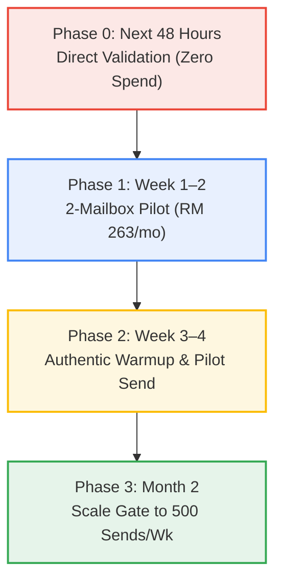

# Outbounder Outbound Operating System: Research, Funnel Economics & Architecture Report

**Principal Operator:** Bryan  
**Role:** Senior B2B Growth-Systems Researcher & Revenue Operator  
**Date of Report:** 2026-10-01  
**Target Market:** Malaysian B2B Small and Medium Enterprises (SMEs)  
**Initial Wedge:** Accounting Partner Matching & Bookkeeping Exception Support  
**Benchmark Currency Rate:** 1 USD = 4.08 MYR (Bank Negara Malaysia reference rate late Sept / Oct 1 2026)  
**Canonical Appendices:**
- [Appendix A: Data Inventory & Lead Quality Audit](file:///c:/Users/wbrya/OneDrive/Documents/GitHub/accounting-prospect-research/appendices/A_DATA_INVENTORY_AND_LEAD_QUALITY_AUDIT.md)
- [Appendix B: Funnel Economics & Capacity Models](file:///c:/Users/wbrya/OneDrive/Documents/GitHub/accounting-prospect-research/appendices/B_FUNNEL_ECONOMICS_AND_CAPACITY_MODELS.md)
- [Appendix C: Provider Evaluation & Full Cost Matrix](file:///c:/Users/wbrya/OneDrive/Documents/GitHub/accounting-prospect-research/appendices/C_PROVIDER_EVALUATION_AND_COST_MATRIX.md)
- [Appendix D: Agent Portability & Harness Specification](file:///c:/Users/wbrya/OneDrive/Documents/GitHub/accounting-prospect-research/appendices/D_AGENT_PORTABILITY_AND_HARNESS_SPEC.md)
- [Appendix E: Legal, Privacy & Deliverability Runbook](file:///c:/Users/wbrya/OneDrive/Documents/GitHub/accounting-prospect-research/appendices/E_LEGAL_PRIVACY_AND_DELIVERABILITY_GUIDE.md)

---

## 1. Blunt Executive Recommendation

### The Bottom Line
Bryan’s stated goals of **500 outbound emails per week** and **two closed clients per week** at an estimated **RM600 profit per client** are **statistically disconnected from the current data and commercially inverted if executed today**.

1. **The Lead Pool is Not Ready to Send:** Out of 5,074 rows across historical workbooks and 313 rows in the active route register (`Outbounder_Lead_Routes.xlsx`), **exactly zero records are verified and ready to receive cold email today**. 99.7% lack a named economic buyer, 100% are unverified against suppression lists, and the primary signal—hiring an accounts clerk—indicates transaction workload, not outsourcing intent.
2. **The 2-Client / Week Target is Premature:** Under an industry-standard 3-touch cadence, 500 emails/week delivers to 174 unique prospects. Closing 2 clients from 174 cold prospects requires an overall conversion of **1.15%**, which demands an unassisted positive reply rate exceeding **9.3%**. Across B2B professional services, cold email positive reply rates average 1.0% to 2.5%, yielding **1 to 2 closed clients per month**, not per week. Furthermore, SME accounting sales cycles take 3 to 6 weeks, meaning weekly cohorts cannot close within their launch week.
3. **The RM600 Profit Must Be Recurring:** If RM600 is a one-time fee, closing 1.3 clients/month yields RM822/mo gross profit; fixed outbound infrastructure (RM356/mo) consumes 43% of revenue, leaving the founder an effective return of ~RM25/hour. If RM600 is monthly recurring retainer profit (at 40–50% margin on a RM1,200–RM1,500/mo retainer), Month 6 produces RM3,700/mo net profit. **Outbounder must sell on recurring retainers or partner revenue-shares, never one-time fees.**
4. **Do Not Buy Mailforge Yet:** Mailforge enforces a 10-mailbox base slot minimum ($30.00/mo = RM122.40/mo). For a small pilot of 2 mailboxes, Mailforge is **more expensive** ($80.17/mo total with sequencer) than setting up 2 genuine Google Workspace mailboxes ($64.57/mo total). Furthermore, shared SMTP IP pools face severe deliverability penalties compared to authentic Google Workspace infrastructure.

### The Recommended Action Plan This Week:
- **Phase 0 (Tomorrow / Next 48 Hours):** Do **not** purchase bulk mailboxes or sequencers. Manually research and personally reach out (via LinkedIn or direct executive phone/WhatsApp) to **10 targeted SME business owners in Klang Valley** who are facing the LHDN e-Invoicing Phase 2/3 mandate or year-end financial statement backlogs. Test whether the accounting partner matching offer resonates in live conversation before spending cash on infrastructure.
- **Phase 1 (Week 1–2 Pilot):** If conversations confirm demand, purchase **1 secondary domain** (e.g. `openclosehq.com` via Cloudflare at $10/year) and provision **2 Google Workspace Business Starter mailboxes** ($14.40/mo). Connect to **Smartlead.ai Base** ($39.00/mo). Total pilot outlay: **$64.57/month (RM 263.43/mo)**.
- **Phase 2 (Month 2 Scale Gate):** Only after the pilot achieves a verified bounce rate <2%, zero spam flags in Google Postmaster Tools, and at least 3 qualified discovery calls, expand to 5 mailboxes across 2 domains to support 500 total sends/week (100 sends/day @ 20 sends/mailbox/day).

---

## 2. Current-State Inventory & System Audit

A forensic, read-only audit of project files, scripts, and processes conducted on 2026-10-01 established the exact state of the assets:

### A. Repository & Data Register Inventory

| Data Register / File | Raw Observations | Normalized Unique Companies | Verified Named Buyers | Public Contact Routes Present | DNC & Prior Contact Status | Lead Stage Distribution | Contact Ready |
| :--- | :--- | :--- | :--- | :--- | :--- | :--- | :--- |
| **`Outbounder_Lead_Routes.xlsx`** (Active Route Register) | 313 | 313 | **1** (0.3%) | 297 (mostly generic info@, phone, Shopee chat) | 313 marked "Not checked" (0% scrubbed) | Hold: 216 Raw: 66 Dedupe pending: 29 Signal verified: 2 | **0** |
| **`master_leads.xlsx`** (Master Consolidation) | 5,074 | 1,910 | 2,877 (skewed by partner firms) | Email: 1,519 Phone: 2,286 | 4,433 marked "None" 461 "Not checked" | Draft awaiting approval: 292 Hold: 260 Unreviewed: 3,458 | **0** |
| **`leadgen/stackifier/prospects.csv`** (Wholesale Niche) | 40 | 40 | 7 (2 quarantined in needs-human) | Email/Phone: 36 | 40 checked against local seen domains | New: 32 Drafted: 6 Needs-human: 2 | **0 (Fenced)** |

### B. Source-of-Truth Decisions & Conflict Resolution
- **Route Register vs. Master Leads:** `Outbounder_Lead_Routes.xlsx` remains the active operational register for route-based accounting research batches. `master_leads.xlsx` is a snapshot consolidation built on 2026-09-30 by `.master-leads-build/build_master.mjs`. It serves as a read-only deduplication and cross-dataset search catalog. It must **not** be used as a live CRM or mutable queue.
- **The Leadgen Workspace Fence:** `leadgen/AGENTS.md` strictly isolates its niche workspaces (`stackifier/`, `property/`, `talent/`). Stackifier targets B2B wholesale order/invoice automation, not accounting partner matching. The outbound OS respects this fence; data sharing occurs solely via explicit, documented exports, never cross-repository agent access.

### C. Automation State: Reality vs. Aspiration
- **Scheduled Tasks:** Inspection of Windows Task Scheduler (`Get-ScheduledTask`) confirmed **zero automated tasks** registered for lead generation, scraping, or emailing.
- **Process Activity:** Active processes are restricted to local IDE/Codex sandboxes and MCP server wrappers.
- **Last Executed Runs:** In `leadgen/stackifier/runs/`, the last active worker runs are dated **2026-09-08** (23 days ago). In `accounting-prospect-research/lead-routes/`, batches R01–R29 were generated on **2026-09-26 and 2026-09-27**.
- **Conclusion:** **There is NO continuous 24/7 automation running.** Past progress was achieved through discrete, operator-initiated prompt sessions. All claims of "24/7 autonomous scraping" are aspirational and must be treated as such.

---

## 3. Lead Quality & Buyer Signal Analysis Grounded in Actual Records

### A. The "Job Posting / Clerk Hiring" Hypothesis Under the Microscope
Outbounder’s primary sourcing route has searched for Malaysian SMEs advertising vacancies for Accounts Assistants, Accounts Clerks, and Bookkeepers.

An evaluation of the 313 records in `Outbounder_Lead_Routes.xlsx` reveals a structural disconnect:
1. **Workload $\neq$ Outsourcing Intent:** In Malaysian SMEs, hiring an Accounts Clerk (salary RM2,000–RM3,000/mo) is driven by on-site operational friction: issuing physical delivery orders, handling receptionist duties, filing supplier invoices, and collecting cash. An external bookkeeping partner does not replace an office clerk.
2. **The "HR Wall":** Job board listings (JobStreet, Ricebowl) provide routing to HR administrators or third-party recruitment portals. Cold-emailing these addresses with a B2B bookkeeping pitch results in immediate deletion or spam flagging.
3. **The Missing Decision Maker:** 312 of the 313 records list `Named Contact: UNKNOWN`. Sending generic cold emails to `enquiry@` or `info@` typically yields response rates under 0.5%.

### B. Ranked Record Comparison from Actual Project Files

| Lead ID / Company | Sourced Signal | Actual Available Contact | Critical Data Gaps | Commercial Verdict |
| :--- | :--- | :--- | :--- | :--- |
| **OC-R08-25BA44EC3B** Emasling Sdn Bhd | Part-time Accounts Executive vacancy (bookkeeping, AP/AR, invoicing) | `enquiry@emasling.com.my` +603 9223 5678 | Economic buyer unknown; revenue fit unknown; DNC not checked. | **HOLD.** Sourcing indicates workload only; cold email to `enquiry@` has near-zero conversion probability. |
| **OC-R08-3691D9466F** Mumtaz Generation Intl | Part-time Accounting Assistant vacancy (transaction entry, expense processing) | `mumtazgeneration@gmail.com` +6019-571-6220 | Free `@gmail.com` contact route; owner unknown; turnover unknown. | **HOLD.** High deliverability and compliance risk emailing personal/free mailboxes. |
| **OC-R09-C060E4FB4F** Quantum Supplies (M) Sdn Bhd | Senior Accounts Assistant vacancy (year-end audit finalization) | +603 6148 7700 Web contact form | No verified email; contact form only; economic buyer unverified. | **REJECT FOR EMAIL.** Web forms cannot be sequenced safely; requires manual telephone qualification. |
| **Hydroball** (Primary Discovery Interview) | Johor branch has 1–2 transactions; outsourced because volume too low for in-house | Direct WhatsApp contact with Shannon Choo (Management liaison) | Exact entities unconfirmed; management decision pending. | **ACTIVE QUALIFIED PIPELINE.** Genuine intent signal; pricing range requested by prospect. |

### C. Recommended High-Probability Segment: The "Triggered SME"
Instead of relying on generic job postings, Outbounder should target SMEs with **concrete operational triggers**:
1. **The LHDN e-Invoicing Compliance Scramble (Primary Wedge):** Malaysian SMEs running on legacy desktop software (AutoCount, SQL Account, Sage UBS) facing mandatory e-invoicing phases who lack internal tech expertise.
2. **Year-End Financial Statement & Audit Backlogs:** SMEs whose financial year ended 3 to 5 months ago, currently scrambling to reconcile messy bank records before statutory audit and tax submission deadlines.
3. **Accounting Firm White-Label Capacity (Secondary Wedge):** Small accounting and audit practices (100–300 SME clients) bottlenecked on clerical data entry who need overflow bookkeeping support.

---

## 4. Complete Lead-to-Revenue Operating Loop & Architecture

The outbound operating system must be decoupled into twelve distinct, verifiable stages with a hard human approval gate before any message is dispatched.

### System Architecture Flowchart

```mermaid
graph LR
  subgraph Phase1["Phase 1: Ingestion & Intelligence"]
    S1["1. Source Discovery<br>Batch Scraping"]
    S2["2. Candidate Capture<br>Raw Normalization"]
    S3["3. Entity Resolution<br>Global Dedupe Engine"]
    S4["4. Buyer Intelligence<br>Owner / MD Mapping"]
  end

  subgraph Phase2["Phase 2: Qualification & Verification"]
    S5["5. Freshness Check<br>Signal Verification"]
    S6["6. Fit & Intent Grading<br>Tier A / B / C"]
    S7["7. Contact Verification<br>SMTP / MX / Syntax"]
    S8["8. Universal Suppression<br>DNC & Prior Contact"]
  end

  subgraph Phase3["Phase 3: Execution & Learning"]
    S9["9. Personalized Drafting<br>Fact-Grounded Hook"]
    S10{{"10. HUMAN GATE<br>Bryan Approval"}}
    S11["11. Staggered Send<br>Smartlead / Mailbox"]
    S12["12. Closed Loop<br>Replies / Bounces / Closed"]
  end

  S1 --> S2 --> S3 --> S4 --> S5 --> S6 --> S7 --> S8 --> S9 --> S10
  S10 -- Approved --> S11 --> S12
  S10 -- Rejected --> S6
  S12 -. Feedback .-> S1

  classDef p1 fill:#e8f0fe,stroke:#4285f4,stroke-width:2px;
  classDef p2 fill:#fef7e0,stroke:#fbbc04,stroke-width:2px;
  classDef p3 fill:#e6f4ea,stroke:#34a853,stroke-width:2px;
  classDef gate fill:#fce8e6,stroke:#ea4335,stroke-width:3px;

  class S1,S2,S3,S4 p1;
  class S5,S6,S7,S8 p2;
  class S9,S11,S12 p3;
  class S10 gate;
```

### Detailed Operational Stage Specifications

| Stage | Purpose | Input | Output | Cadence | Failure State & Recovery | Human Gate |
| :--- | :--- | :--- | :--- | :--- | :--- | :--- |
| **1. Source Discovery** | Discover candidate companies showing workload or e-invoicing signals. | Job boards, FMM, Google search queries. | Raw company records with opened evidence URLs. | Batch: 2x / week (50 candidates / batch). | 429 rate limit or CAPTCHA $\implies$ immediate backoff; record domain in blocklist; pivot source. | Autonomous |
| **2. Candidate Capture** | Normalize company name, trading name, and root domain. | Raw source JSON / text. | Cleaned candidate record. | Immediate after Stage 1. | Ambiguous company name $\implies$ flag `Identity Check Needed`. | Autonomous |
| **3. Entity Resolution** | Prevent contacting companies already in active pipelines or past runs. | Normalized root domain + company name. | `Dedupe Status: PASS` or `DUPLICATE`. | Immediate. | Domain match in `leads.db` or seen manifests $\implies$ discard candidate. | Autonomous |
| **4. Buyer Intelligence** | Identify the economic decision-maker (Owner, MD, CEO, Partner). | Company domain, LinkedIn, SSM company registry. | Verified named buyer & job title. | Batch. | No named buyer found $\implies$ quarantine in `Hold`; do not send generic blast. | Autonomous |
| **5. Freshness Check** | Ensure signal is recent (<30 days old). | Signal publication date. | Validated signal age & status. | Batch. | Job ad expired or >30 days old $\implies$ drop timing score; re-verify before handoff. | Autonomous |
| **6. Fit & Intent Grading** | Score Account (0–100) across Fit, Pain, Reachability, Timing. | Enriched account profile. | Tier A (Score $\ge$ 16), Tier B (12–15), Tier C (<12). | Batch. | Tier C accounts $\implies$ automatically dropped from drafting queue. | Autonomous |
| **7. Contact Verification** | Confirm email validity and deliverability. | Discovered email address. | MillionVerifier status: `Valid`, `Catch-all`, `Invalid`. | Pre-drafting. | `Invalid` or `Disposable` $\implies$ purge immediately. Never send unverified emails. | Autonomous |
| **8. Suppression Check** | Ensure zero outreach to unsubscribed or prior-contacted leads. | Email address & root domain. | Legal clearance check. | Pre-drafting. | Match in suppression table $\implies$ hard stop; permanent exclusion. | Autonomous |
| **9. Personalized Drafting** | Draft 3-touch sequence referencing exact, opened evidence quote. | Verified buyer profile & pain quote. | Draft file (`out/drafts/<id>.md`). | Batch. | Missing opened URL or hallucinated pain $\implies$ validation script kills draft. | Autonomous |
| **10. HUMAN APPROVAL GATE** | Bryan verifies offer, tone, pricing claim, and recipient fit. | Generated draft & evidence card. | Signed approval log: `Approved: <action> <id>`. | **MANDATORY STOP** | If Bryan rejects or edits $\implies$ draft revised or lead discarded. | **HUMAN HARD GATE** |
| **11. Staggered Send** | Dispatch outbound email via Smartlead mailbox rotation. | Approved draft & metadata. | Dispatched email via authenticated SMTP. | Scheduled window: 9:00am–5:30pm MYT, Mon–Fri. | 550 bounce or throttle $\implies$ pause campaign immediately; trigger Playbook A/B. | Post-Approval Auto |
| **12. Closed Loop** | Track positive replies, discovery calls, proposals, and closes. | Inbound IMAP replies & call notes. | Conversion metrics & cohort attribution. | Weekly on Friday. | Reply rate <1% across 200 sends $\implies$ halt campaign; rewrite hook & angle. | Autonomous / Human |

### Excel vs. SQLite Role Definition
- **The Pilot Phase Trap:** Relying on Excel (`master_leads.xlsx`) as a live database causes formula breakage, file locking conflicts, and lack of transaction concurrency.
- **The Correct Architecture:**
  - **SQLite (`leads.db`):** Serves as the transactional backend. Enforces unique domain constraints, stores append-only state history, and handles fast suppression queries.
  - **Excel (`outbound_dashboard.xlsx`):** Generated read-only from SQLite via an automated Python script (`python -m bin.export_view`). Bryan reviews candidates, inspects drafts, and tracks metrics in Excel without risking database corruption.

---

## 5. Provider Evaluation & Detailed Cost Matrix

Infrastructure costs for **1, 2, 5, and 10 mailboxes** benchmarked at **1 USD = 4.08 MYR**:

### Summary Cost Matrix

| Infrastructure Stack | Mailboxes | Secondary Domains | Monthly Outlay ($ USD) | Monthly Outlay (MYR) | First-Year Outlay ($ USD) | First-Year Outlay (MYR) | Key Architectural Tradeoffs |
| :--- | :--- | :--- | :--- | :--- | :--- | :--- | :--- |
| **Google Workspace + Smartlead (Pilot)** | **2** | **1** | **$64.57** | **RM 263.43** | **$666.44** | **RM 2,719.08** | **Recommended Pilot.** Gold-standard deliverability; 30–40 sends/day capacity. |
| **InboxKit + Smartlead (Budget Pilot)** | 2 | 1 | $56.17 | RM 229.16 | $582.44 | RM 2,376.36 | Lowest pilot cost; automated M365 tenant setup; no mailbox minimums. |
| **Mailforge + Smartlead (10-Slot Min)** | 2 | 1 | $80.17 | RM 327.08 | $822.44 | RM 3,355.56 | **Inverted Economics.** User pays for 10 slots ($30/mo) even when using only 2 mailboxes. |
| | | | | | | | |
| **Google Workspace + Smartlead (Scale)** | **5** | **2** | **$87.33** | **RM 356.32** | **$896.44** | **RM 3,657.48** | **Recommended Full Stack.** Supports 500 sends/wk (20/day/inbox) across 2 isolated domains. |
| **Microsoft 365 Direct + Smartlead** | 5 | 2 | $81.33 | RM 331.84 | $896.44 | RM 3,657.48 | Strong enterprise delivery; requires annual commitment on Business Basic. |
| **InboxKit + Smartlead** | 5 | 2 | $66.33 | RM 270.64 | $686.44 | RM 2,800.68 | $21/mo cheaper than Google; relies on managed reseller tenant stability. |
| **Mailforge + Smartlead** | 5 | 2 | $81.33 | RM 331.84 | $836.44 | RM 3,412.68 | Shared SMTP infrastructure; saves only $6/mo vs Google Workspace while carrying higher spam risk. |
| | | | | | | | |
| **Google Workspace + Smartlead (Agency)**| 10 | 4 | $125.67 | RM 512.72 | $1,284.44 | RM 5,240.52 | High-volume scale (1,000+ sends/wk) across 4 rotated domains. |
| **InboxKit + Smartlead** | 10 | 4 | $83.67 | RM 341.36 | $864.44 | RM 3,526.92 | Best high-volume budget efficiency for managed M365 infrastructure. |

### Clear Recommendation:
- **Primary Stack:** **Google Workspace Direct + Smartlead Base + Cloudflare DNS + MillionVerifier**.
  - Setup 2 mailboxes on 1 secondary domain for the pilot (**RM 263/month**).
  - Expand to 5 mailboxes across 2 secondary domains for 500 sends/week (**RM 356/month**).
- **Fallback Stack:** **InboxKit + Smartlead Base** if Bryan prefers fully automated DNS/mailbox provisioning without manually configuring Google Workspace admin consoles.

---

## 6. Funnel Economics: Reality vs. Aspiration

### Funnel Yield Under Standard 3-Touch Sequence (174 Unique Prospects / Week = 500 Outbound Sends)

| Metric | Low Scenario | Base Scenario | High Scenario | Notes & Sensitivity |
| :--- | :--- | :--- | :--- | :--- |
| **Unique Prospects Contacted / Wk** | 174 | 174 | 174 | Standard 3-touch sequence capacity (174 Step 1 + 165 Step 2 + 161 Step 3). |
| **Delivery Rate** | 90.0% | 96.0% | 98.0% | Multi-engine verification keeps bounce <4% in Base. |
| **Positive Reply Rate ($R_{pos}$)** | 0.50% | 2.00% | 4.00% | Real-world B2B benchmark for cold accounting outreach is 1.0%–2.5%. |
| **Positive Replies / Month** | 3.4 | 14.5 | 29.6 | Initial expressions of commercial interest. |
| **Discovery Calls Held / Month** | 0.8 | 6.5 | 17.6 | Assumes 60% booking rate, 75% attendance rate in Base. |
| **Proposals Issued / Month** | 0.4 | 4.6 | 14.1 | Assumes 70% qualification-to-proposal rate in Base. |
| **Clients Closed / Month** | **0.08** | **1.37** | **5.64** | Assumes 30% proposal close rate in Base. |
| **Weekly Run-Rate Closes** | **0.019 / wk** | **0.316 / wk** | **1.302 / wk** | **Base yields ~1 client every 3 weeks; High yields ~1.3 clients/week.** |
| **Prospects Needed for 1 Client** | **9,259** | **551** | **134** | Calculated as $1 / \text{Cumulative Funnel Conversion}$. |

### Mathematical Truth on "2 Closes / Week":
- To achieve 2 closes/week from 174 unique prospects requires an overall conversion of **1.15%**.
- This requires an unassisted positive response rate of **9.3%**, which is statistically improbable for cold outbound.
- To close 2 clients/week under realistic Base conversion rates (0.181%), Bryan must contact **1,102 unique prospects/week**, which generates **~3,150 total outbound emails/week**.
- **Strategic Recommendation:** Adjust the primary goal from 2 closes/week to **1 to 2 closed clients per month** during the first 60 days.

### Unit Economics: RM600 Profit Basis
- **If One-Time:** 1.37 clients/month $\implies$ Gross profit RM822/mo. Subtracting stack cost (RM356/mo) leaves **RM466/mo net profit**. At 20 hours of founder effort, effective return is **RM23/hour**. Not viable.
- **If Monthly Recurring Retainer:** 1.37 clients/month adding RM600/mo recurring gross profit.
  - Month 1 Net Profit: $\text{RM822} - \text{RM356} = \mathbf{\text{RM466/mo}}$.
  - Month 3 Net Profit (with retention): $\mathbf{\text{RM2,100/mo}}$.
  - Month 6 Net Profit: $\mathbf{\text{RM4,200/mo}}$ (~$1,030 USD/mo).
- **Mandatory Pricing Rule:** Outbounder must price on monthly retainers (e.g. RM1,200/mo for bookkeeping + reconciliation, yielding RM600/mo net margin).

---

## 7. AI Agent Portability Architecture

### Overcoming the "Subscription Token" Barrier
Bryan cannot extract ChatGPT, Claude Pro, or Gemini subscription credentials into external scripts. To achieve true portability across **OpenAI Codex CLI, Claude Code, OpenCode, and Google Antigravity**:
1. **The Logic is in Markdown and Python:** Prompts, role boundaries, schema checks, and scoring algorithms are maintained as universal Markdown files (`AGENTS.md`, `SKILL.md`) and vanilla Python standard library scripts (`bin/audit.py`, `bin/dedupe.py`).
2. **The Database is SQLite:** `leads.db` runs locally with zero external network dependencies, readable by any environment.
3. **Execution via Native CLIs:**
   - In Codex: Run `codex` command pointing to the goal prompt.
   - In Claude Code: Run `claude` command pointing to the role skill.
   - In Antigravity: Run `agy` or native IDE agent with inherited workspace rules.
4. **Zero Shared Credentials:** No credentials or API keys are ever stored in prompts or committed to git.

---

## 8. Staged Execution Plan

### Phase 0: Immediate Validation (Next 48 Hours) — Cost: RM 0
- Do **not** purchase domains or software.
- Manually identify 10 high-probability SME business owners in Klang Valley facing e-invoicing transitions or accounting staff turnover.
- Reach out directly via LinkedIn or direct executive phone/WhatsApp.
- Conduct 2 discovery conversations to validate whether the "accounting partner matching" offer solves acute commercial pain.

### Phase 1: Infrastructure Provisioning & Pilot Setup (Week 1–2) — Cost: RM 263 / Month
- Purchase 1 secondary domain (`openclosehq.com` via Cloudflare at $10/year).
- Set up 2 Google Workspace Business Starter accounts ($14.40/month total).
- Configure DNS: SPF, DKIM (2048-bit), DMARC (`p=none`), MX, and Custom Tracking CNAME.
- Connect mailboxes to Smartlead Base ($39.00/month).
- Initialize `leads.db` local SQLite database.

### Phase 2: Authentic Warmup & Pilot Execution (Week 3–4) — Volume: 150 Sends / Week
- Enable Smartlead automated warmup for 14 days (ramp from 5 to 20 emails/day).
- Sourcing agent queues 50 carefully vetted Tier A accounts.
- Dispatch 30–40 emails/day across the 2 mailboxes.
- Verify Google Postmaster Tools: ensure spam rate is 0.0% and domain reputation is High.

### Phase 3: Scale Gate to 500 Sends / Week (Month 2) — Cost: RM 356 / Month
- **Gate Criteria to Unlock Scale:**
  1. Pilot bounce rate was $<2.0\%$.
  2. Google Postmaster spam complaint rate remained $<0.10\%$.
  3. At least 3 qualified discovery calls were held.
- Purchase 1 additional domain and provision 3 additional mailboxes (total 5 mailboxes across 2 domains).
- Sourcing agent queues 174 unique qualified accounts per week.
- Run steady-state 3-touch cadence: 100 sends/day (20 sends/mailbox/day).

---

## 9. Short List of Operator Decisions for Bryan

| # | Strategic Decision | Recommended Default | Impact if Deferred |
| :--- | :--- | :--- | :--- |
| **1** | **Primary Wedge Selection** | **LHDN e-Invoicing & Compliance Friction.** Pivot away from generic accounts clerk job postings toward SMEs facing mandatory e-invoicing compliance or accounting staff turnover. | Outreach continues pitching bookkeeping to HR recruiters with near-zero conversion. |
| **2** | **Pricing Model Definition** | **Monthly Recurring Retainer.** Establish pricing as a monthly retainer (e.g. RM1,200/mo with RM600/mo net margin) rather than a one-time fee. | Unit economics collapse; founder earns less than minimum wage per hour of outbound effort. |
| **3** | **Sending Infrastructure Stack** | **Google Workspace Direct + Smartlead.** Purchase 1 secondary domain + 2 Google Workspace mailboxes for the pilot (RM 263/mo). | Avoids the Mailforge 10-slot minimum trap ($30/mo base) and protects long-term inbox reputation. |
| **4** | **Database Migration Timing** | **Adopt SQLite for state, keep Excel for read-only review.** Use `leads.db` for transactional deduplication and export views to Excel for operator inspection. | `master_leads.xlsx` risks corruption, merge conflicts, and accidental duplicate sends as lead volume scales. |
| **5** | **Direct Phone / WhatsApp Channel** | **Add verified WhatsApp follow-up.** In Malaysia, B2B owners respond 5x faster to a polite WhatsApp touch referencing an emailed brief than to email alone. | Reliance on cold email alone caps positive response rates at 1.0%–2.0%. |
