# AUTONOMOUS ACCOUNTING & GENERAL LEDGER ENGINE (ALE)
## System Architecture & Engineering Blueprint: Next-Generation Autonomous Double-Entry Ledger Core
**Author:** Staff Financial Systems Architect & Tech Lead (Jane Street & Stripe Standards)  
**Target:** 100x Superior Replacement to `tax-agentic-overhaul`  
**Classification:** Canonical Financial Systems Architecture Specification  

---

## 0. EXECUTIVE SUMMARY & FIRST PRINCIPLES

### 0.1 The 100x Delta: Why `tax-agentic-overhaul` Needed to Evolve
The initial implementation in `tax-agentic-overhaul` pioneered rule-based transaction reconciliation (`value_recon/rules.py`, `gate.py`) and agentic review loops. However, in an institutional corporate environment, it hit four fatal architectural barriers:

1. **Absence of an Event-Sourced General Ledger (GL)**: It operated purely on row-by-row reconciliation between two flat files (LHS vs RHS) without anchoring transactions into an immutable, double-entry Chart of Accounts (COA) where $\sum \text{Debits} \equiv \sum \text{Credits}$.
2. **Probabilistic Contamination of Financial State**: Unstructured OCR output was processed directly in ephemeral agent memory without an isolated, transactional **Draft Staging Queue**. If an LLM hallucinated a number or split, there was no database-level constraint preventing corrupted records.
3. **Loss of Spatial Provenance**: When extracting financial figures from tax forms, invoices, and bank statements, pixel bounding boxes (`[x, y, w, h, page]`) were discarded upon conversion to JSON strings. When an auditor asks *"Where did this $14,250.80 come from?"*, the system could not visually highlight the source pixel on the original PDF.
4. **Agent Math Hallucination**: AI agents were expected to reason over arithmetic adjustments (gross-to-net gateway fees, withholding taxes, depreciation schedules) directly in English prompts, violating the core principle that **LLMs must never do arithmetic**.

### 0.2 The Six Invariant Tenets of the Outbounder Autonomous Ledger Engine (ALE)
To achieve zero-hallucination institutional accounting, ALE is engineered around six fundamental tenets:

1. **The Wall of Separation**: Ingestion is probabilistic (Vision/OCR). General Ledger mutation is strictly deterministic ($\sum \text{Debits} \equiv \sum \text{Credits}$). Unverified OCR data can **NEVER** write directly to the GL; it must pass through an isolated Staging Queue.
2. **Append-Only Event Sourcing**: Historical records are never updated or deleted (`REVOKE UPDATE, DELETE`). Errors are corrected exclusively through compensating reversal transactions (`storno` accounting).
3. **Multi-Layered Balance Invariants**: Double-entry balance is asserted at Value Object instantiation (Python domain model), verified at the MCP Gateway, and enforced at the database engine level via PostgreSQL `DEFERRABLE INITIALLY DEFERRED` constraint triggers.
4. **Dynamic Deterministic Tool Graph**: When the agent encounters non-trivial financial logic (e.g. Section 109B withholding tax, straight-line/MACRS depreciation, multi-currency FX translation), it **synthesizes and executes a deterministic Python tool node within a directed acyclic graph (DAG)** rather than calculating numbers in prose.
5. **Cryptographic Proof Triad**: Every ledger entry emits a tamper-evident audit receipt binding $H_{\text{raw}}$ (source document hash), $H_{\text{schema}}$ (canonical RFC-8785 JSON extraction), and $H_{\text{gl}}$ (ledger entry hash).
6. **Bi-Temporal Truth**: Every entry maintains dual timestamps—`effective_date` (economic event date) and `recorded_at` (system ingestion time)—enabling exact retrospective "as-of" balance sheet replay.

---

## 1. END-TO-END SYSTEM TOPOLOGY & ARCHITECTURAL OVERVIEW

The Outbounder Autonomous Ledger Engine is structured into six strictly decoupled layers:

```mermaid
flowchart LR
    subgraph Layer1["Layer 1: Multimodal Ingestion"]
        A1["WhatsApp Image / Email PDF / Bank Feed"] --> A2["Spatial OCR and Bounding Box Engine"]
        A2 --> A3["Provenanced Document Envelope"]
    end

    subgraph Layer2["Layer 2: Draft Staging Queue"]
        A3 --> B1["Staging Queue (Isolated State)"]
        B1 --> B2["Multi-Way Continuous Reconciler"]
        B2 --> B3{"Reconciliation Match?"}
        B3 -- "Matched (100%)" --> B4["Validated Journal Draft"]
        B3 -- "Exception / Variance" --> B5["Human-in-the-Loop Review Queue"]
    end

    subgraph Layer3["Layer 3: Event-Sourced GL Core"]
        B4 --> C1["PostgreSQL ACID Boundary"]
        C1 --> C2["Deferred Balance Constraint Trigger"]
        C2 --> C3["Append-Only Event Log (Postings)"]
        C3 --> C4["CQRS Materialized Account Balances"]
    end

    subgraph Layer4["Layer 4: MCP Gateway"]
        D1["Autonomous Financial Agent"] <--> D2["Model Context Protocol Server"]
        D2 <--> B1
        D2 <--> C4
    end

    subgraph Layer5["Layer 5: Dynamic Tool Graph"]
        D1 --> E1["Agent Synthesizes Tool Spec"]
        E1 --> E2["Deterministic Python DAG Node"]
        E2 --> E3["Execution Sandbox and Unit Test"]
        E3 --> B4
    end

    subgraph Layer6["Layer 6: Cryptographic Proof"]
        C3 --> F1["SHA-256 Digest Triad"]
        F1 --> F2["Visual PDF Bounding Box Overlay"]
        F2 --> F3["Auditor Tamper-Evident Receipt"]
    end
```

---
