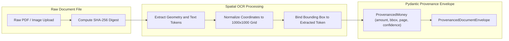

## 2. LAYER 1: MULTIMODAL INGESTION & SPATIAL COORDINATE NORMALIZATION

### 2.1 Unstructured Ingestion Channels
An institutional autonomous accounting system must handle messy, real-world source documents without losing fidelity:
1. **WhatsApp Mobile Photo Uploads**: Mobile camera snapshots of physical paper receipts, wrinkled thermal POS printouts, and delivery orders. These inputs are characterized by perspective skew, lighting gradients, shadows, and low resolution.
2. **Vendor Invoices & PDF Portals**: High-resolution digital PDFs, e-Invoices (PEPPOL / LHDN MyInvois XML/JSON), and corporate statements from SaaS vendors (AWS, Google Workspace, OpenAI, Adobe) and physical suppliers.
3. **Automated Bank Feeds & Treasury Streams**: Structured statements (ISO 20022 CAMT.053, SWIFT MT940, BAI2, OFX, CSV) and programmatic API webhooks (Plaid, Stripe, Wise, Mercury, Brex).

### 2.2 Preserving Spatial Pixel Provenance
In legacy accounting OCR pipelines, documents are converted to raw text strings or flat dictionaries. This discards the spatial coordinates of the source figures. When an external auditor, tax authority, or CFO asks:
> *"What evidence proves that this $14,250.80 was an IT equipment expense and not an unallowable director personal drawing?"*

Legacy software can only link to the raw 20-page PDF, forcing a human to read through the document manually.

In ALE, every financial value extracted from an unstructured document is anchored to a **`ProvenancedMoney`** object that permanently binds:
- The numeric value as an exact fixed-point `Decimal`.
- The ISO 4217 currency code.
- The normalized bounding box `[x_min, y_min, x_max, y_max]` on a canonical `[0, 1000]` unit grid.
- The 1-indexed document page number.
- The optical character recognition (OCR) confidence score `[0.0, 1.0]`.
- The raw OCR text token as originally scanned.



### 2.3 Formal Pydantic V2 Domain Models

```python
from __future__ import annotations
from decimal import Decimal
from typing import List, Optional, Dict, Any
from datetime import date
from pydantic import BaseModel, Field, field_validator


class SpatialBoundingBox(BaseModel):
    """
    Normalized spatial bounding box on a 1000x1000 coordinate grid.
    Permits resolution-independent rendering across mobile screens,
    web viewports, and high-DPI PDF rasterizers.
    """
    page: int = Field(..., ge=1, description="1-indexed document page number")
    x_min: float = Field(..., ge=0.0, le=1000.0, description="Left coordinate (0-1000)")
    y_min: float = Field(..., ge=0.0, le=1000.0, description="Top coordinate (0-1000)")
    x_max: float = Field(..., ge=0.0, le=1000.0, description="Right coordinate (0-1000)")
    y_max: float = Field(..., ge=0.0, le=1000.0, description="Bottom coordinate (0-1000)")

    @field_validator("x_max")
    @classmethod
    def validate_x_order(cls, v: float, info) -> float:
        if "x_min" in info.data and v < info.data["x_min"]:
            raise ValueError(f"x_max ({v}) cannot be less than x_min ({info.data['x_min']})")
        return v

    @field_validator("y_max")
    @classmethod
    def validate_y_order(cls, v: float, info) -> float:
        if "y_min" in info.data and v < info.data["y_min"]:
            raise ValueError(f"y_max ({v}) cannot be less than y_min ({info.data['y_min']})")
        return v


class ProvenancedMoney(BaseModel):
    """
    Financial value bound immutably to its spatial source on the physical document.
    """
    amount: Decimal = Field(..., description="Exact currency amount with fixed-point scale")
    currency: str = Field(default="USD", min_length=3, max_length=3)
    bbox: SpatialBoundingBox
    confidence: float = Field(..., ge=0.0, le=1.0, description="OCR token confidence")
    raw_text: str = Field(..., description="Exact string token extracted by OCR engine")


class ExtractedLineItem(BaseModel):
    """
    Individual line item extracted from an invoice or receipt.
    """
    line_number: int = Field(..., ge=1)
    description: str
    quantity: Decimal = Field(default=Decimal("1.0"))
    unit_price: ProvenancedMoney
    total_amount: ProvenancedMoney
    account_code_suggestion: Optional[str] = None
    tax_code_suggestion: Optional[str] = None


class ProvenancedDocumentEnvelope(BaseModel):
    """
    Canonical envelope wrapping the extracted payload of any unstructured source document.
    """
    document_id: str
    sha256_hash: str = Field(..., min_length=64, max_length=64)
    vendor_name: str
    invoice_number: str
    invoice_date: date
    subtotal: ProvenancedMoney
    tax_amount: Optional[ProvenancedMoney] = None
    total_amount: ProvenancedMoney
    line_items: List[ExtractedLineItem]
    raw_storage_uri: str
    metadata: Dict[str, Any] = Field(default_factory=dict)
```

---
