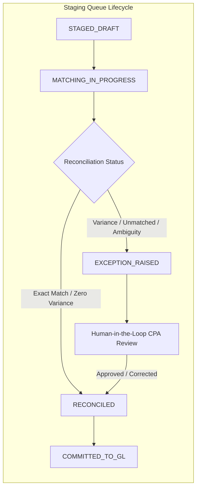
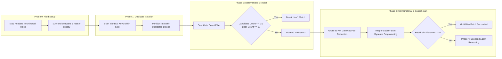

## 3. LAYER 2: DRAFT STAGING QUEUE & CONTINUOUS RECONCILIATION ENGINE

### 3.1 The Wall of Separation: Ingestion vs. General Ledger
In flawed AI accounting prototypes, an OCR or vision agent parses an invoice and immediately runs `INSERT INTO general_ledger ...`.
This violates the foundational tenet of financial systems: **Ingestion is probabilistic; the General Ledger is deterministic.**

If an OCR engine misreads an invoice number, swaps debit and credit, or hallucinates an extra digit, writing directly to the General Ledger permanently pollutes financial statements, distorts retained earnings, and triggers tax audits.

Therefore, ALE introduces an absolute **Wall of Separation**:
- Raw documents and bank feeds enter an isolated, transient **Draft Staging Queue**.
- In the Staging Queue, transactions are subjected to deterministic balance verification, duplicate detection, and multi-way continuous reconciliation.
- A transaction can transition to the General Ledger **only** when its double-entry balance is mathematically proven ($\sum \text{Debits} \equiv \sum \text{Credits}$) and its source evidence is cryptographically verified.



### 3.2 PostgreSQL Staging Queue Schema

```sql
-- ============================================================================
-- DRAFT STAGING QUEUE & PROVENANCE REPOSITORY
-- ============================================================================

CREATE TYPE staging_status_enum AS ENUM (
    'STAGED_DRAFT',
    'MATCHING_IN_PROGRESS',
    'RECONCILED',
    'EXCEPTION_RAISED',
    'COMMITTED_TO_GL',
    'REJECTED'
);

CREATE TABLE staging_documents (
    id UUID PRIMARY KEY DEFAULT uuid_generate_v4(),
    sha256_hash VARCHAR(64) NOT NULL UNIQUE,
    source_channel VARCHAR(32) NOT NULL, -- 'WHATSAPP', 'EMAIL_PDF', 'BANK_FEED', 'API'
    vendor_name VARCHAR(255) NOT NULL,
    invoice_number VARCHAR(128),
    invoice_date DATE NOT NULL,
    total_amount NUMERIC(28, 4) NOT NULL,
    currency VARCHAR(3) NOT NULL DEFAULT 'USD',
    raw_storage_uri TEXT NOT NULL,
    provenance_envelope JSONB NOT NULL,
    status staging_status_enum NOT NULL DEFAULT 'STAGED_DRAFT',
    created_at TIMESTAMPTZ NOT NULL DEFAULT clock_timestamp(),
    updated_at TIMESTAMPTZ NOT NULL DEFAULT clock_timestamp()
);

CREATE INDEX idx_staging_doc_status ON staging_documents(status);
CREATE INDEX idx_staging_doc_hash ON staging_documents(sha256_hash);

CREATE TABLE staging_queue_postings (
    id UUID PRIMARY KEY DEFAULT uuid_generate_v4(),
    staging_document_id UUID NOT NULL REFERENCES staging_documents(id) ON DELETE CASCADE,
    account_code_suggested VARCHAR(32) NOT NULL,
    direction posting_direction_enum NOT NULL,
    amount NUMERIC(28, 4) NOT NULL CHECK (amount > 0),
    currency VARCHAR(3) NOT NULL DEFAULT 'USD',
    bounding_box JSONB, -- {page: 1, x_min: 100, y_min: 200, ...}
    created_at TIMESTAMPTZ NOT NULL DEFAULT clock_timestamp()
);

CREATE INDEX idx_staging_postings_doc ON staging_queue_postings(staging_document_id);
```

---

### 3.3 The 4-Phase Multi-Way Continuous Reconciliation Engine
ALE upgrades the foundational principles established in `tax/notes/recon-crux.md` and `value_recon/rules.py` into an industrial 4-phase reconciliation pipeline.



#### Phase 0: Parameter Setup & Canonical Field Mapping
Before matching begins, input columns across heterogeneous sources (e.g. Stripe payout report vs HSBC bank statement) are mapped to standard roles:
- `sum-and-compare`: The core financial value being reconciled (e.g. `amount` or `total`). Summed during split/merge operations.
- `match-exactly`: Hard categorical constraints that must be 100% identical (e.g. `[currency, tenant_id]`).
- `match-within-delta`: Continuous fields evaluated within strict tolerance bounds (e.g. `date` within 3 business days).
- `match-by-name`: Counterparty names normalized via string fuzzy cleaning, an approved corporate alias dictionary, and vector embeddings.

#### Phase 1: Duplicate Isolation (`with-duplicates-groups`)
In real-world data, identical transaction amounts occur frequently (e.g. five monthly subscriptions of $9.99 on the same date). 
If a naive algorithm encounters duplicate amounts, it risks cross-matching transaction A on the left with transaction B on the right.
- Any row that shares identical `match-exactly` attributes and identical `sum-and-compare` values with another row on the same side is partitioned into a **`with-duplicates-group`**.
- Rows without duplicates proceed directly to Phase 2.
- Rows in duplicate groups are tagged with `dup_group_id` and resolved using strict timestamp ordering or counterparty metadata.

#### Phase 2: Deterministic Bijection Matching (Type A)
For all un-grouped rows, ALE searches for candidates satisfying:
$$\text{candidate} = \{ r \in \text{RHS} \mid \text{exact\_key}(l) = \text{exact\_key}(r) \land |l.\text{amount} - r.\text{amount}| \le \delta_{\text{amount}} \land |l.\text{date} - r.\text{date}| \le \delta_{\text{date}} \}$$
- A match is declared **IF AND ONLY IF**:
  1. The Left-Hand-Side row $l$ has **exactly one candidate** in RHS.
  2. That RHS candidate $r$ has **exactly one candidate back** in LHS.
- This bidirectional exclusivity invariant completely eliminates greedy false-positive matching.

#### Phase 3: Gross-to-Net Gateway Fee Deduction & Integer Subset-Sum Dynamic Programming (Type B)
Real-world e-commerce and SaaS payments almost never appear as clean 1-to-1 matches on bank statements. Payment processors (Stripe, PayPal, Adyen) deduct transaction fees and bundle multiple customer charges into a single net batch payout:
$$\text{Bank Deposit (Net)} \equiv \sum_{i=1}^{k} \text{Gross Invoices}_i - \sum_{i=1}^{k} \text{Gateway Fees}_i$$

*Example*:
- Customer Invoices: Invoice #101 ($500.00) + Invoice #102 ($500.00) = $1,000.00 Gross.
- Stripe Fees: 2.9% + $0.30 per charge = $14.80 + $14.80 = $29.60 Fee.
- Bank Statement Deposit: $970.40.

To solve this deterministically without LLM arithmetic:
1. **Fee Model Deduction**: The system queries the merchant's configured gateway fee schedule ($P\% + \$F$).
2. **Integer Scaling**: All values are multiplied by $100$ and cast to 64-bit integers (e.g. $970.40 \to 97040$) to eliminate binary floating-point drift.
3. **Bounded Subset-Sum Dynamic Programming**: The engine searches for a subset of candidate invoices whose calculated net payout matches the bank deposit within a bounded search space ($k \le 20$, date window $\le 5$ days):

```python
def solve_gross_to_net_batch(
    bank_net_cents: int,
    candidate_invoices: list[dict],
    fee_pct: Decimal,
    fixed_fee_cents: int
) -> Optional[list[str]]:
    """
    Solves multi-invoice to single bank deposit reconciliation using integer DP.
    """
    n = len(candidate_invoices)
    # Target search bounded to prevent exponential blowup
    for r in range(1, min(n + 1, 15)):
        for combo in itertools.combinations(candidate_invoices, r):
            gross_sum = sum(inv["gross_cents"] for inv in combo)
            total_fee = sum(
                int((Decimal(inv["gross_cents"]) * fee_pct).quantize(Decimal("1"), rounding=ROUND_HALF_EVEN))
                + fixed_fee_cents
                for inv in combo
            )
            calculated_net = gross_sum - total_fee
            if calculated_net == bank_net_cents:
                return [inv["id"] for inv in combo]
    return None
```

#### Phase 4: Bounded Agent Reasoning (Type C)
If deterministic algorithms fail to find a match, the transaction is routed to an AI reasoning agent. However, to prevent hallucination, the agent operates within strict spatial boundaries:
- **Spatial Nearest Bounds**: The agent is provided only the nearest $N$ candidate rows ($N \le 15$) within a tight date window (max $\pm 7$ days).
- **Prohibited Operations**: The agent is strictly prohibited from altering amounts or declaring a match without citing specific counterparty narrative tokens.
- If ambiguity remains, the agent raises an **`EXCEPTION_RAISED`** event, placing the transaction in the Human-in-the-Loop review queue.

---
