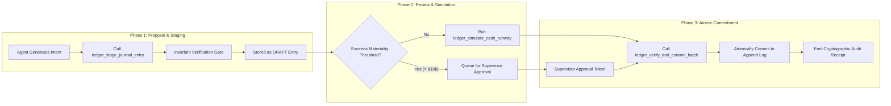

## 5. LAYER 4: MODEL CONTEXT PROTOCOL (MCP) SERVER INTERFACE FOR AGENTS

### 5.1 The Agent Firewall & Two-Phase Commit Pipeline
LLMs are non-deterministic, probabilistic pattern matchers. If an AI agent has direct write access to a General Ledger, hallucinations, syntax blunders, and miscalculations will inevitably corrupt company books.

The Model Context Protocol (MCP) server acts as a **strictly typed deterministic firewall**:
- Agents cannot write raw SQL queries.
- Agents cannot directly manipulate account balances.
- Agents must follow a strict **Two-Phase Commit** lifecycle:
  1. **Stage**: The agent stages a proposed entry into `DRAFT` status via `ledger_stage_journal_entry`.
  2. **Verify & Validate**: The system verifies balance invariants, account status, and business policies.
  3. **Commit**: The entry is atomically committed via `ledger_verify_and_commit_batch`. High-value transactions exceeding materiality thresholds require a human supervisor token.



---

### 5.2 The 6 Standardized MCP Tool Contracts

The MCP server exposes 6 standardized tools following the Model Context Protocol JSON-RPC 2.0 specification:

#### 1. `ledger_get_account_balances`
- **Description**: Retrieves current or point-in-time account balances from the General Ledger.
- **Parameters**:
  - `account_ids` (`list[str]`, optional): Target account UUIDs. If omitted, returns all active accounts.
  - `as_of` (`str`, optional): ISO 8601 date (`YYYY-MM-DD`) for retrospective point-in-time queries.
  - `currency` (`str`, default `"USD"`): Reporting currency.
- **Returns**:
  ```json
  [
    {
      "account_id": "b1a2c3d4-...",
      "code": "1010",
      "name": "Operating Cash - HSBC",
      "type": "ASSET",
      "normal_balance": "DEBIT",
      "debit_total": "125000.00",
      "credit_total": "32150.00",
      "net_balance": "92850.00",
      "currency": "USD"
    }
  ]
  ```

#### 2. `ledger_stage_journal_entry`
- **Description**: Stages a proposed multi-leg journal entry into the isolated `DRAFT` pool without mutating the General Ledger.
- **Parameters**:
  - `memo` (`str`, required): Business purpose of the transaction.
  - `effective_date` (`str`, required): Economic event date (`YYYY-MM-DD`).
  - `postings` (`list[dict]`, required): List of splits containing `{account_id, direction: "DEBIT"|"CREDIT", amount: str, currency: str}`.
  - `metadata` (`dict`, optional): Provenance tags, vendor name, invoice reference.
  - `idempotency_key` (`str`, required): Unique hash to prevent duplicate staging.
- **Returns**:
  ```json
  {
    "draft_id": "e5f6a7b8-...",
    "status": "DRAFT",
    "total_debits": "1500.00",
    "total_credits": "1500.00",
    "is_balanced": true,
    "memo": "Stripe Gateway Payout & Fees",
    "postings_count": 3
  }
  ```

#### 3. `ledger_verify_and_commit_batch`
- **Description**: Atomically validates balance invariants and commits one or more staged drafts into immutable `POSTED` general ledger records.
- **Parameters**:
  - `draft_ids` (`list[str]`, required): UUIDs of staged drafts to commit.
  - `actor_id` (`str`, required): Identifier of committing agent or human supervisor.
  - `approval_token` (`str`, optional): Cryptographic token required for transactions exceeding materiality limits.
- **Returns**:
  ```json
  {
    "batch_status": "COMMITTED",
    "committed_count": 1,
    "entries": [
      {
        "journal_entry_id": "e5f6a7b8-...",
        "entry_number": 1042,
        "status": "POSTED",
        "effective_date": "2026-10-01",
        "memo": "Stripe Gateway Payout & Fees"
      }
    ]
  }
  ```

#### 4. `ledger_query_trial_balance`
- **Description**: Computes the company-wide Trial Balance as of a specified cutoff date, proving that sum of all debits equals sum of all credits.
- **Parameters**:
  - `as_of` (`str`, optional): Cutoff date (`YYYY-MM-DD`). Defaults to current date.
- **Returns**:
  ```json
  {
    "as_of_date": "2026-10-02",
    "lines": [
      {"code": "1010", "name": "Cash", "type": "ASSET", "debit": "92850.00", "credit": "0.00"},
      {"code": "4010", "name": "SaaS Revenue", "type": "REVENUE", "debit": "0.00", "credit": "92850.00"}
    ],
    "total_debits": "92850.00",
    "total_credits": "92850.00",
    "net_difference": "0.00",
    "is_balanced": true
  }
  ```

#### 5. `ledger_simulate_cash_runway`
- **Description**: Evaluates cash balance projections and runway depletion across future months under specified burn rate scenarios without mutating ledger state.
- **Parameters**:
  - `current_date` (`str`, required): Starting projection date.
  - `cash_account_id` (`str`, required): Account ID representing liquid cash/bank.
  - `monthly_burn_rate` (`str`, required): Net monthly cash burn.
  - `projection_months` (`int`, default `12`): Number of forward months to simulate.
- **Returns**:
  ```json
  {
    "initial_cash": "45950.00",
    "monthly_burn_rate": "4000.00",
    "runway_months_estimate": 11.5,
    "depletion_month_offset": 12,
    "monthly_projections": [
      {"month_offset": 1, "projected_cash": "41950.00", "is_depleted": false},
      {"month_offset": 2, "projected_cash": "37950.00", "is_depleted": false}
    ]
  }
  ```

#### 6. `ledger_reverse_transaction`
- **Description**: Executes an immutable compensating reversal (`storno`) of an existing `POSTED` journal entry.
- **Parameters**:
  - `journal_entry_id` (`str`, required): UUID of the posted journal entry to reverse.
  - `reason` (`str`, required): Justification for the reversal.
  - `idempotency_key` (`str`, optional): Deduplication key.
- **Returns**:
  ```json
  {
    "reversal_entry_id": "c77cb8f4-...",
    "entry_number": 1043,
    "reverses_original_id": "e5f6a7b8-...",
    "status": "POSTED",
    "effective_date": "2026-10-02",
    "reason": "Voided due to customer invoice cancellation"
  }
  ```

---
