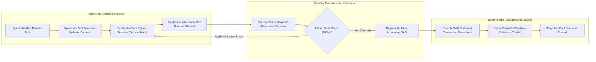
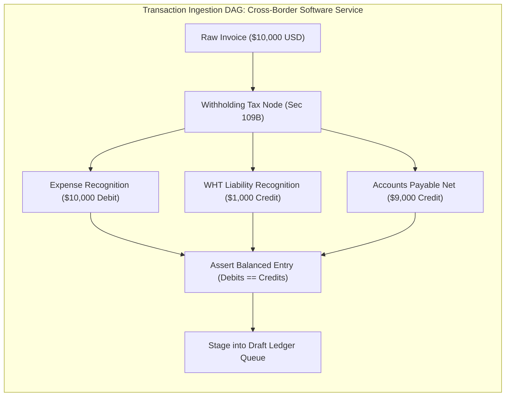

## 6. LAYER 5: DYNAMIC DETERMINISTIC TOOL GRAPH ENGINE

### 6.1 The Paradigm: Agent as Deterministic Tool Compiler
In corporate finance and tax compliance, regulatory rules are vast, nuanced, and jurisdiction-dependent:
- **Malaysian Section 109B Withholding Tax**: 10% gross withholding on technical fees, management services, and software consultancy paid to non-resident entities, remitted within 30 days to LHDN.
- **US MACRS Depreciation**: IRS Publication 946 half-year and mid-quarter conventions across 3, 5, 7, 15, and 27.5-year property classes.
- **Singapore GST Partial Exemption**: Apportionment of input tax under Regulation 28 de minimis rules ($10,000/month or 5% of total input tax).
- **Payment Gateway Fee Splitting**: Stripe (2.9% + $0.30) vs PayPal (3.49% + $0.49) interchange models.

Legacy systems attempt to either:
1. **Hardcode every rule into monolithic software**: Becomes bloated, rigid, and instantly obsolete when tax laws change.
2. **Ask the LLM to calculate the numbers in text**: The LLM hallucinates arithmetic, rounds incorrectly, and produces illegal tax filings.

ALE introduces a third paradigm: **The Agent as a Deterministic Tool Compiler**.

When an agent encounters a transaction requiring domain math:
- The Agent **DOES NOT** calculate the final numbers in natural language.
- Instead, the Agent **synthesizes, verifies, and executes a deterministic Python tool node within a Directed Acyclic Graph (DAG)**.



---

### 6.2 The Accounting DAG Architecture
Financial computations are modeled as an execution graph where nodes represent pure, deterministic transformations:



Every node in the DAG must satisfy three mathematical properties:
1. **Purity**: Zero network I/O, zero global state, zero side effects. The node is a pure function of its inputs.
2. **Fixed-Point Precision**: All operations use `decimal.Decimal` and `ROUND_HALF_EVEN`. Binary floating-point arithmetic is banned.
3. **Proof Emission**: The node emits both the computed financial splits and a reproducible execution trace.

---

### 6.3 Concrete Tool Synthesizers & Reference Implementations

Below are three production-grade deterministic calculation engines synthesized and managed by ALE:

#### Example 1: Straight-Line Asset Depreciation Engine
Generates complete monthly asset schedules across arbitrary recovery periods with zero floating-point drift:

```python
from decimal import Decimal, ROUND_HALF_EVEN
from datetime import date
from typing import List, Dict, Any

ROUND_CENTS = Decimal("0.01")


def calculate_straight_line_depreciation_schedule(
    asset_cost: str,
    salvage_value: str,
    useful_life_years: int,
    placed_in_service_date: str,
    accum_deprec_account_id: str,
    deprec_expense_account_id: str
) -> List[Dict[str, Any]]:
    """
    Computes penny-perfect monthly depreciation schedules.
    Enforces that sum of monthly postings matches exact depreciable base.
    """
    cost = Decimal(asset_cost)
    salvage = Decimal(salvage_value)
    depreciable_base = cost - salvage
    total_months = useful_life_years * 12

    monthly_deprec = (depreciable_base / Decimal(total_months)).quantize(ROUND_CENTS, rounding=ROUND_HALF_EVEN)
    p_date = date.fromisoformat(placed_in_service_date)
    schedule = []
    accumulated = Decimal("0.00")

    for month_idx in range(1, total_months + 1):
        m_year = p_date.year + (p_date.month + month_idx - 1) // 12
        m_month = (p_date.month + month_idx - 1) % 12 or 12
        period_date = date(m_year, m_month, 28)

        # Handle final penny residual on the last month
        if month_idx == total_months:
            monthly_amount = depreciable_base - accumulated
        else:
            monthly_amount = monthly_deprec
            accumulated += monthly_amount

        schedule.append({
            "memo": f"Depreciation Month {month_idx}/{total_months} for Asset",
            "effective_date": period_date.isoformat(),
            "postings": [
                {
                    "account_id": deprec_expense_account_id,
                    "direction": "DEBIT",
                    "amount": str(monthly_amount),
                    "currency": "USD"
                },
                {
                    "account_id": accum_deprec_account_id,
                    "direction": "CREDIT",
                    "amount": str(monthly_amount),
                    "currency": "USD"
                }
            ]
        })
    return schedule
```

#### Example 2: Malaysian Section 109B Withholding Tax Engine
Calculates statutory withholding for payments to non-resident contractors (e.g. AWS, overseas consultants), generating balanced splits between Gross Expense, Withholding Tax Payable (LHDN), and Net Accounts Payable:

```python
def calculate_malaysian_withholding_tax_109b(
    gross_invoice_amount: str,
    currency: str,
    expense_account_id: str,
    ap_vendor_account_id: str,
    wht_payable_account_id: str,
    tax_rate: Decimal = Decimal("0.10") # Statutory 10% Section 109B
) -> Dict[str, Any]:
    gross = Decimal(gross_invoice_amount).quantize(ROUND_CENTS, rounding=ROUND_HALF_EVEN)
    wht_amount = (gross * tax_rate).quantize(ROUND_CENTS, rounding=ROUND_HALF_EVEN)
    net_payable = gross - wht_amount

    # Mathematically assert balance: Gross == Net + WHT
    assert gross == (net_payable + wht_amount), "Withholding split broke mathematical balance"

    return {
        "gross_amount": str(gross),
        "wht_deducted": str(wht_amount),
        "net_payable_to_vendor": str(net_payable),
        "postings": [
            {
                "account_id": expense_account_id,
                "direction": "DEBIT",
                "amount": str(gross),
                "currency": currency,
                "memo": "Gross Professional / Technical Services Expense"
            },
            {
                "account_id": wht_payable_account_id,
                "direction": "CREDIT",
                "amount": str(wht_amount),
                "currency": currency,
                "memo": "Section 109B Withholding Tax Payable to LHDN (due 30 days)"
            },
            {
                "account_id": ap_vendor_account_id,
                "direction": "CREDIT",
                "amount": str(net_payable),
                "currency": currency,
                "memo": "Net Accounts Payable to Non-Resident Vendor"
            }
        ]
    }
```

#### Example 3: Payment Gateway Gross-to-Net Fee Splitter
Decomposes a customer payment into Gross Revenue, Payment Processing Fees, and Net Cash Deposited:

```python
def calculate_stripe_gross_to_net_split(
    gross_charge_amount: str,
    revenue_account_id: str,
    cash_clearing_account_id: str,
    gateway_fee_account_id: str,
    percentage_fee: Decimal = Decimal("0.029"), # 2.9%
    fixed_fee: Decimal = Decimal("0.30"),       # $0.30
    currency: str = "USD"
) -> Dict[str, Any]:
    gross = Decimal(gross_charge_amount).quantize(ROUND_CENTS, rounding=ROUND_HALF_EVEN)
    fee = ((gross * percentage_fee) + fixed_fee).quantize(ROUND_CENTS, rounding=ROUND_HALF_EVEN)
    net_cash = gross - fee

    assert gross == (net_cash + fee), "Gross fee split broke balance invariant"

    return {
        "gross_revenue": str(gross),
        "gateway_fee": str(fee),
        "net_deposited": str(net_cash),
        "postings": [
            {
                "account_id": cash_clearing_account_id,
                "direction": "DEBIT",
                "amount": str(net_cash),
                "currency": currency,
                "memo": "Net Cash Deposited from Payout"
            },
            {
                "account_id": gateway_fee_account_id,
                "direction": "DEBIT",
                "amount": str(fee),
                "currency": currency,
                "memo": "Stripe Payment Processing Fee Expense"
            },
            {
                "account_id": revenue_account_id,
                "direction": "CREDIT",
                "amount": str(gross),
                "currency": currency,
                "memo": "Gross Customer Subscription Revenue"
            }
        ]
    }
```

---
