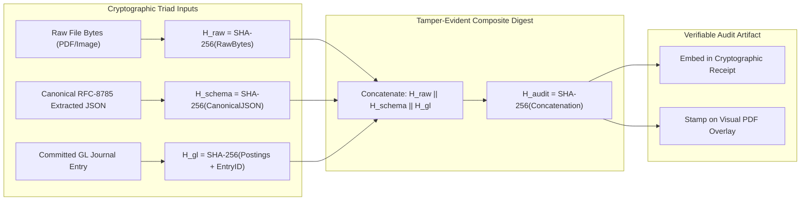

## 7. LAYER 6: TAMPER-EVIDENT CRYPTOGRAPHIC AUDIT PROOF & VISUAL BOUNDING BOX REVIEWER

### 7.1 The Cryptographic Digest Triad
In conventional accounting systems, internal audit trials rely on mutable database audit logs or system event tables. These logs can be cleared, truncated, or edited by database administrators.

To establish institutional, zero-trust verification, ALE implements the **Cryptographic Digest Triad**:

$$H_{\text{audit}} = \text{SHA-256}\Big(H_{\text{raw}} \;\parallel\; H_{\text{canonical\_schema}} \;\parallel\; H_{\text{gl\_entry}}\Big)$$

Where:
1. **$H_{\text{raw}}$**: Cryptographic SHA-256 digest of the raw source file bytes (image or PDF) as ingested from the vendor or client.
2. **$H_{\text{canonical\_schema}}$**: Cryptographic SHA-256 digest of the extracted JSON envelope canonicalized using RFC-8785 (JSON Canonicalization Scheme - JCS) to eliminate whitespace and key-ordering variance.
3. **$H_{\text{gl\_entry}}$**: Cryptographic SHA-256 digest of the committed PostgreSQL journal entry ID, sequence number, effective date, and balanced posting allocations.



#### Mathematical Properties of the Triad
- **Tamper Evidence**: If anyone alters a single pixel on the source PDF receipt, $H_{\text{raw}}$ changes.
- **Extraction Integrity**: If an agent alters a line item or vendor name in JSON, $H_{\text{canonical\_schema}}$ changes.
- **Ledger Invariance**: If a rogue administrator edits a debit or credit in the database, $H_{\text{gl\_entry}}$ changes.
- In all three cases, the composite digest $H_{\text{audit}}$ breaks, immediately alerting auditors to unauthorized mutation.

---

### 7.2 Visual Audit Overlay PDF Generator (`PyMuPDF`)

ALE generates an audit-ready, visual PDF for every processed transaction. Using `PyMuPDF` (`fitz`), the engine takes the original source document, renders translucent highlight rectangles over the exact bounding boxes where figures were parsed, and stamps a digital audit certificate in the header:

```python
import fitz # PyMuPDF
import hashlib
from typing import List, Dict, Any


def generate_visual_audit_overlay_pdf(
    input_pdf_path: str,
    output_pdf_path: str,
    bounding_boxes: List[Dict[str, Any]],
    audit_metadata: Dict[str, Any]
) -> str:
    """
    Renders visual bounding box highlights and a cryptographic audit banner
    onto the source document PDF without altering the underlying text layer.
    """
    doc = fitz.open(input_pdf_path)
    
    # Calculate raw file hash
    with open(input_pdf_path, "rb") as f:
        raw_hash = hashlib.sha256(f.read()).hexdigest()

    for item in bounding_boxes:
        page_idx = item["page"] - 1 # 0-indexed in PyMuPDF
        if page_idx >= len(doc):
            continue
        page = doc[page_idx]
        p_width = page.rect.width
        p_height = page.rect.height

        # Denormalize 1000x1000 coordinate grid to actual page dimensions
        bbox = item["bbox"]
        x0 = (bbox["x_min"] / 1000.0) * p_width
        y0 = (bbox["y_min"] / 1000.0) * p_height
        x1 = (bbox["x_max"] / 1000.0) * p_width
        y1 = (bbox["y_max"] / 1000.0) * p_height

        rect = fitz.Rect(x0, y0, x1, y1)

        # Highlight color: Green for high confidence (>= 0.95), Amber for review (< 0.95)
        color = (0.0, 0.8, 0.2) if item.get("confidence", 1.0) >= 0.95 else (1.0, 0.7, 0.0)

        # Draw translucent highlight rectangle
        annot = page.add_rect_annot(rect)
        annot.set_colors(stroke=color, fill=color)
        annot.set_opacity(0.3)
        annot.update()

        # Add tooltip annotation
        label = f"Parsed: {item.get('label', '')} | Amount: {item.get('amount', '')} | Conf: {item.get('confidence', 0.0):.2f}"
        page.add_text_annot(fitz.Point(x0, y0 - 10), label)

    # Stamp Cryptographic Audit Banner on Page 1
    page1 = doc[0]
    banner_rect = fitz.Rect(10, 10, page1.rect.width - 10, 45)
    page1.draw_rect(banner_rect, color=(0.1, 0.1, 0.2), fill=(0.95, 0.96, 0.98), width=1)
    
    cert_text = (
        f"OUTBOUNDER AUDIT CERTIFICATE | JE #{audit_metadata.get('entry_number')} | "
        f"GL Entry ID: {audit_metadata.get('journal_entry_id', '')[:16]}...\\n"
        f"SHA-256 Digest: {audit_metadata.get('audit_digest', '')[:32]}... | "
        f"Verified: {audit_metadata.get('verified_at', '')}"
    )
    page1.insert_text(fitz.Point(20, 26), cert_text, fontsize=7, color=(0.1, 0.1, 0.2))

    doc.save(output_pdf_path)
    doc.close()
    return output_pdf_path
```

---

### 7.3 Human-in-the-Loop (HITL) Exception Resolution
Autonomous operation does not mean unsupervised hallucination. When the system detects uncertainty, it halts and routes the case to human CPAs:

#### Exception Triggers
1. **Low OCR Confidence**: Any financial token with OCR confidence $< 0.90$.
2. **Reconciliation Variance**: Multi-way bank deposit vs invoice reconciliation with non-zero residual variance exceeding configured rounding tolerance ($> \$0.01$).
3. **High-Materiality Transactions**: Any single expenditure or journal entry exceeding the organization's pre-configured materiality threshold ($> \$10,000$).
4. **New / Unknown Counterparties**: Invoices from vendors without an established Tax Identification Number (TIN) or Chart of Accounts mapping.

#### The Supervisor Resolution Cockpit
- Human CPAs receive an interactive review card via Slack, WhatsApp, or the web cockpit.
- The review card presents:
  1. The side-by-side Visual PDF with highlighted bounding boxes.
  2. The proposed debit/credit journal entry splits.
  3. One-click actions: `[Approve & Sign Token]`, `[Re-map Account Code]`, `[Reject / Flag as Fraud]`.
- Upon approval, the supervisor's cryptographic signature is appended to `committed_by`, and the transaction atomically commits to the General Ledger.

---
