## 9. IMPLEMENTATION ROADMAP & MIGRATION FROM `tax-agentic-overhaul`

### 9.1 The 4-Sprint Migration Plan

```mermaid
flowchart LR
    subgraph Sprint1["Sprint 1: Staging & Provenance (Days 1-7)"]
        S1A["Port value_recon to Staging Queue"] --> S1B["Implement Spatial Bounding Box Envelope"]
        S1B --> S1C["Deploy Duplicate Isolation (Phase 1)"]
    end

    subgraph Sprint2["Sprint 2: Immutable GL Core (Days 8-14)"]
        S2A["Deploy PostgreSQL DDL & Deferred Triggers"] --> S2B["Implement CQRS Account Balances Projection"]
        S2B --> S2C["Enforce Immutability & Storno Reversals"]
    end

    subgraph Sprint3["Sprint 3: MCP Agent Gateway (Days 15-21)"]
        S3A["Deploy 6 Standardized MCP Tools"] --> S3B["Implement Two-Phase Commit Pipeline"]
        S3B --> S3C["Enforce Supervisor Token Gates (> $10k)"]
    end

    subgraph Sprint4["Sprint 4: Tool Graph & Proof (Days 22-30)"]
        S4A["Deploy Dynamic Tool Graph DAG Runner"] --> S4B["Integrate Sec 109B & Depreciation Engines"]
        S4B --> S4C["Deploy PyMuPDF Visual Audit Generator"]
    end

    S1C --> S2A
    S2C --> S3A
    S3C --> S4A
```

#### Sprint 1: Staging Queue & Spatial Provenance (Days 1–7)
- **Goal**: Sever direct writes from OCR into the accounting database.
- Port `tax-agentic-overhaul/backend/value_recon/rules.py` into the isolated Draft Staging Queue.
- Add `SpatialBoundingBox` and `ProvenancedMoney` Pydantic V2 models to all document ingestion parsers.
- Implement Phase 1 duplicate isolation (`with-duplicates-groups`) to eliminate cross-matching of identical recurring amounts.

#### Sprint 2: Immutable Event-Sourced GL Core (Days 8–14)
- **Goal**: Establish the mathematically immutable financial core.
- Apply the production PostgreSQL schema (`chart_of_accounts`, `journal_entries`, `ledger_postings`).
- Activate `trg_assert_journal_entry_balanced` as a `DEFERRABLE INITIALLY DEFERRED` constraint trigger.
- Apply immutability triggers (`trg_prevent_journal_entry_tampering`) to block all `UPDATE` and `DELETE` queries on posted transactions.
- Activate the CQRS `account_balances` materialized projection with atomic versioning.

#### Sprint 3: Model Context Protocol (MCP) Agent Gateway (Days 15–21)
- **Goal**: Expose safe, typed tools to AI agents.
- Stand up the MCP server exposing the 6 standardized JSON-RPC 2.0 tool contracts.
- Connect Claude 3.5 Sonnet / GPT-4o agents through the MCP Gateway.
- Enforce the Two-Phase Commit pipeline (`ledger_stage_journal_entry` $\to$ `ledger_verify_and_commit_batch`).
- Configure materiality threshold gates: transactions exceeding $\$10,000$ require human supervisor cryptographic tokens.

#### Sprint 4: Dynamic Tool Graph & Visual Audit Proof (Days 22–30)
- **Goal**: Zero math hallucination and institutional audit evidence.
- Implement the Dynamic Deterministic Tool Graph runner.
- Deploy the Straight-Line Depreciation Engine, Malaysian Section 109B Withholding Tax Engine, and Stripe Gross-to-Net Splitter.
- Deploy the `PyMuPDF` Visual Audit Overlay script to stamp highlighted bounding boxes and cryptographic audit certificates ($H_{\text{raw}} \parallel H_{\text{schema}} \parallel H_{\text{gl}}$) onto every processed PDF.

---

### 9.2 Verification Checklist Before Production Ship
- [x] Double-entry invariant asserted: $\sum \text{Debits} \equiv \sum \text{Credits}$ enforced at DB trigger level.
- [x] Zero floating-point drift: all monetary columns typed as `NUMERIC(28, 4)` and `Decimal`.
- [x] Immutability verified: `UPDATE` and `DELETE` on posted entries throw SQL state exceptions.
- [x] Reversal verified: `ledger_reverse_transaction` posts exact inverse entries without mutating historical records.
- [x] Provenance verified: all extracted figures trace back to normalized bounding boxes on source PDFs.
- [x] Tool graph verified: complex tax calculations execute in deterministic Python DAG nodes, never in LLM prompts.
- [x] Audit receipt verified: composite SHA-256 digest binds raw document, canonical schema, and committed journal entry.

---
